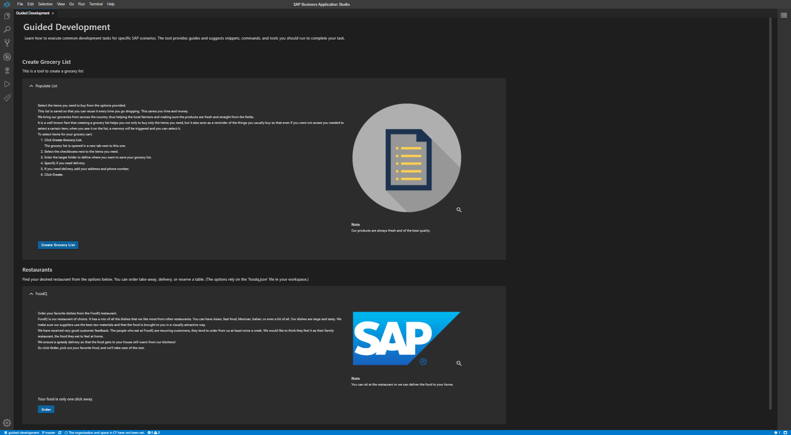

# Guided Development



## Description

The Guided Development extension allows developers to add generic code pieces to their
project and provides a wizard-like experience with minimal development effort.

This is part of the [app-studio-toolkit][mono-repo] monorepo and currently contains:

- [VSCode Extension](./packages/backend) — the backend part, which communicates with the
  system and hosts the Guide Center. Runs as a VSCode extension or a node.js application.
- [Guided Development UI](./packages/frontend) — the Guided Development standalone vue.js
  application, bundled into the extension.
- [![npm-guided-development-types][npm-types-image]][npm-types-url] [@sap_oss/guided-development-types](./packages/types)
  — the shared type signatures consumed by Guided Development contributors.
- [Contributor examples](./examples) — example VSCode extensions that show how to contribute
  guides to the Guide Center.

[mono-repo]: https://github.com/SAP/app-studio-toolkit
[npm-types-image]: https://img.shields.io/npm/v/@sap_oss/guided-development-types.svg
[npm-types-url]: https://www.npmjs.com/package/@sap_oss/guided-development-types

## Architecture

The backend starts in `packages/backend/src/extension.ts`, discovers guide
contributors, registers commands and the Guide Center, and hosts webview panels.
Contributors provide guide data and actions using the shared types. The Vue 3
frontend uses Vue CLI; backend `frontend:build` and `frontend:copy` build it and
copy the result into `dist/media/`. The backend also has a standalone WebSocket
entry point for browser development. The extension requires `SAPOSS.app-studio-toolkit`.

## Build and testing

Use Node 24.x and pnpm 11.1.1. Run `pnpm install` and `pnpm ci` at the monorepo
root first so workspace dependencies are compiled. For subsequent package changes:

```sh
# Inside projects/guided-development/packages/backend:
pnpm compile
pnpm test
pnpm coverage
# Inside projects/guided-development/packages/frontend:
pnpm build
pnpm test
```

Backend unit tests use Mocha/Chai with nyc coverage. Frontend tests use Jest via
`vue-cli-service test:unit`; frontend `pnpm coverage` runs that suite too.
Backend `pnpm ci` compiles, tests, bundles, builds/copies the frontend, and packages
the VSIX. See the [backend guide](./packages/backend/README.md) for WebSocket development.

## Configuration

No project `.env` or credentials are required for local development. The
[backend manifest](./packages/backend/package.json) exposes
`Guided Development.loggingLevel` (default `error`) and
`Guided Development.sourceLocationTracking` (default `false`) in VS Code Settings.
Use source-location tracking only for debugging. Contributor extensions configure
the guides and actions shown to users; examples live under `examples/`.
For standalone WebSocket development, `PORT` overrides the default port 8081.

## CI and release

The root [CI workflow](../../.github/workflows/ci.yml) validates all package CI
scripts on Node 24.x for pushes and PRs targeting `main`. On pushes to `main`,
the [release workflow](../../.github/workflows/release.yml) uses Changesets to
open a version PR or release. Backend and frontend share a fixed version group in
[the Changesets configuration](../../.changeset/config.json). The private backend
is packaged as a VSIX; matching artifacts are uploaded to GitHub Releases.
The types package and contributor examples are ignored by Changesets. Follow the
root [release process](../../CONTRIBUTING.md#release-process); Marketplace
publishing is not performed by these workflows.

## Support

To get more help, support, and information please open a GitHub
[issue](https://github.com/SAP/app-studio-toolkit/issues/new?labels=project%3Aguided-development).

## Report an Issue

See [reporting and handling issues](../../CONTRIBUTING.md#report-an-issue) in the root CONTRIBUTING.md.
