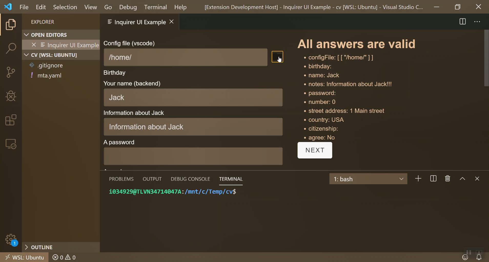

# sample-vscode-extension

[](inquirer-gui-vscode-browse-file.mp4 "Video of file browser")

## Requirements

Run `pnpm install` and `pnpm ci` at the monorepo root first to build the UI libraries.
Then, inside this example directory, build/copy the Vite sample and compile the extension:

```sh
pnpm copy-dist
pnpm compile
```

`copy-dist` builds the sibling `sample-app-vite` and copies its `dist/` into this
extension's `dist/` directory.

Then launch the `Launch Extension` debug configuration.
