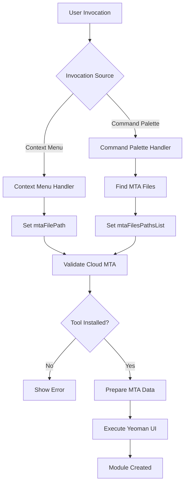
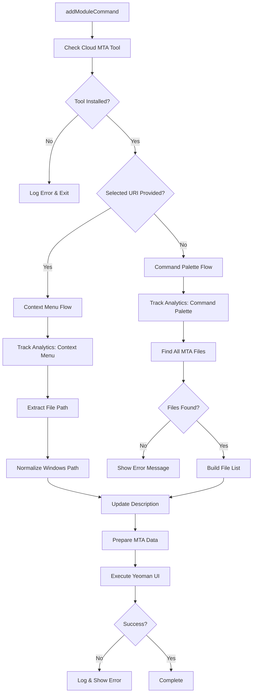
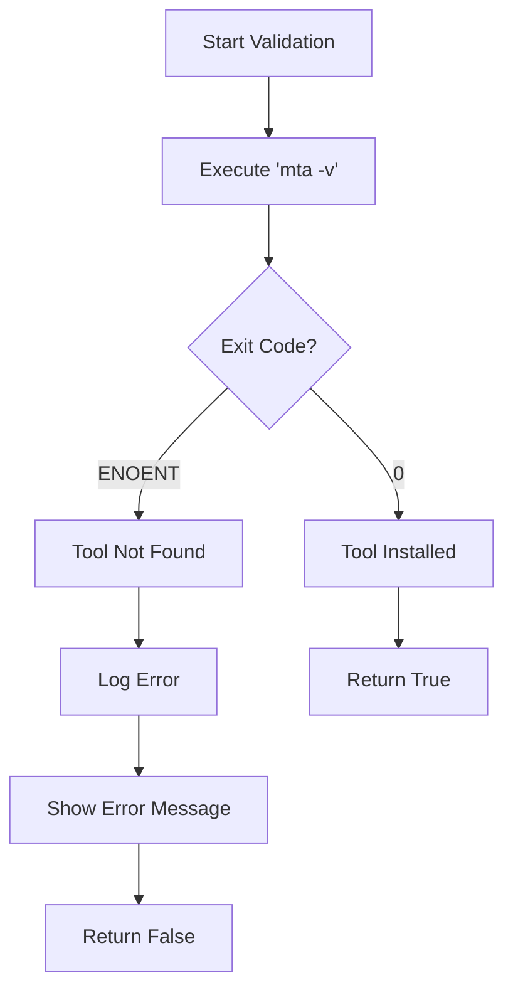
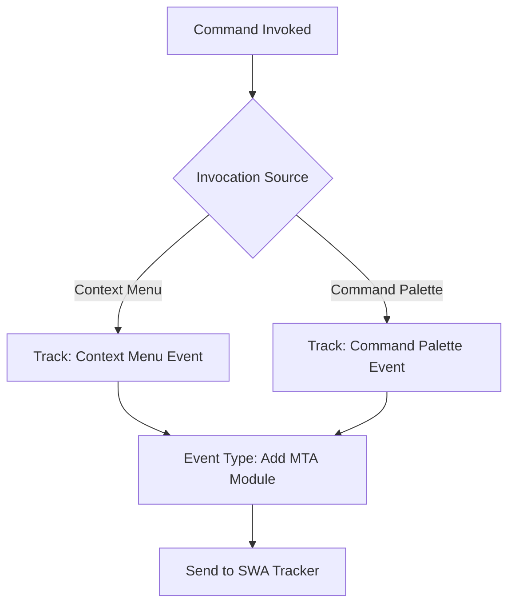
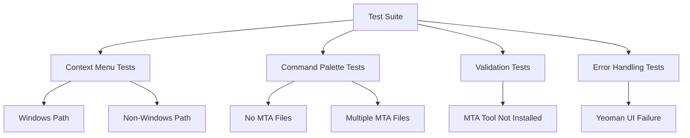

# Add Module Command

## Introduction

The **Add Module Command** is a core feature of the vscode-mta-tools extension that enables developers to add new modules to existing SAP Multi-Target Application (MTA) projects. This command provides an interactive wizard interface powered by Yeoman UI, allowing users to select from various module templates and configure them according to their project needs. The command can be invoked either from the VS Code command palette or through the context menu when right-clicking on an `mta.yaml` file. Before executing, the command validates that the Cloud MTA tool is installed in the environment and locates available MTA project descriptor files in the workspace.

Sources: [src/commands/addModuleCommand.ts:1-85](../../../src/commands/addModuleCommand.ts#L1-L85)

## Architecture Overview

The Add Module Command follows a command pattern architecture with the `AddModuleCommand` class serving as the primary orchestrator. The command integrates with several utility modules and external systems to provide a seamless module creation experience.



Sources: [src/commands/addModuleCommand.ts:18-84](../../../src/commands/addModuleCommand.ts#L18-L84)

## Command Class Structure

The `AddModuleCommand` class encapsulates all logic for adding modules to MTA projects. It maintains state for the selected MTA file path and manages the interaction flow between the user and the Yeoman UI generator.

### Class Properties

| Property            | Type                  | Description                                                       |
| ------------------- | --------------------- | ----------------------------------------------------------------- |
| `mtaFilePath`       | `string \| undefined` | Path to the selected mta.yaml file when invoked from context menu |
| `mtaFilesPathsList` | `string \| undefined` | Comma-separated list of all mta.yaml file paths in workspace      |
| `logger`            | `IChildLogger`        | Logger instance for tracking command execution and errors         |

Sources: [src/commands/addModuleCommand.ts:13-18](../../../src/commands/addModuleCommand.ts#L13-L18)

### Key Constants

| Constant               | Value                                         | Description                                    |
| ---------------------- | --------------------------------------------- | ---------------------------------------------- |
| `CLOUD_MTA_COMMAND`    | `"mta"`                                       | CLI command name for Cloud MTA tool validation |
| `ORIGINAL_DESCRIPTION` | `messagesYeoman.select_generator_description` | Original template selection description text   |

Sources: [src/commands/addModuleCommand.ts:10-11](../../../src/commands/addModuleCommand.ts#L10-L11)

## Command Execution Flow

The `addModuleCommand` method implements the main execution logic, handling both context menu and command palette invocations with different workflows.



Sources: [src/commands/addModuleCommand.ts:20-84](../../../src/commands/addModuleCommand.ts#L20-L84)

### Context Menu Invocation

When invoked from the context menu (right-clicking on an mta.yaml file), the command receives the file URI directly and uses it as the target MTA project.

```typescript
if (selected) {
  getSWA().track(messages.EVENT_TYPE_ADD_MODULE, [
    messages.CUSTOM_EVENT_CONTEXT_MENU,
  ]);
  this.mtaFilePath = selected.path;
  this.mtaFilePath = Utils.isWindows()
    ? trimStart(this.mtaFilePath, "/")
    : this.mtaFilePath;
  this.logger.info(`The user selection file path: ${this.mtaFilePath}`);
  messagesYeoman.select_generator_description =
    ORIGINAL_DESCRIPTION +
    `\n\n${messagesYeoman.select_mtaFile_hint} ${this.mtaFilePath}`;
}
```

The path normalization handles Windows-specific path formatting by removing leading slashes. The command also updates the generator description to display the selected file path to the user.

Sources: [src/commands/addModuleCommand.ts:30-44](../../../src/commands/addModuleCommand.ts#L30-L44)

### Command Palette Invocation

When invoked from the command palette, the command searches the workspace for all available mta.yaml files and presents them to the user for selection.

```typescript
const mtaYamlFilesPaths = await workspace.findFiles(
  "**/mta.yaml",
  "**/node_modules/**"
);
const len = mtaYamlFilesPaths.length;
if (len === 0) {
  this.mtaFilesPathsList = undefined;
  this.logger.error(messages.NO_MTA_FILE);
  void window.showErrorMessage(messages.NO_MTA_FILE);
  return;
} else {
  const mtaYamlFilesPathsNormalized = Utils.getFilePaths(mtaYamlFilesPaths);
  this.mtaFilesPathsList = mtaYamlFilesPathsNormalized.join(",");
  this.logger.info(
    `The file paths available for selection are: ${this.mtaFilesPathsList}`
  );
}
```

The search excludes node_modules directories to avoid false positives from dependencies. If no MTA files are found, an error message is displayed and the command exits early.

Sources: [src/commands/addModuleCommand.ts:48-64](../../../src/commands/addModuleCommand.ts#L48-L64)

## Prerequisite Validation

Before proceeding with module creation, the command validates that the Cloud MTA tool is installed in the user's environment.



The validation is performed by the `Utils.isCliToolInstalled` utility method, which attempts to execute the `mta -v` command. If the command fails with an `ENOENT` error code, it indicates the tool is not installed, and the user is presented with an error message directing them to the installation documentation.

Sources: [src/commands/addModuleCommand.ts:21-29](../../../src/commands/addModuleCommand.ts#L21-L29), [src/utils/utils.ts:107-120](../../../src/utils/utils.ts#L107-L120)

## Data Transfer Object

The command prepares an `IMtaData` interface to pass context information to the Yeoman UI generator.

```typescript
interface IMtaData {
  mtaFilePath: string | undefined;
  mtaFilesPathsList: string | undefined;
}
```

This interface encapsulates either a single selected MTA file path (context menu) or a list of available MTA files (command palette), allowing the Yeoman UI to present the appropriate selection interface to the user.

Sources: [src/commands/addModuleCommand.ts:7-10](../../../src/commands/addModuleCommand.ts#L7-L10)

## Yeoman UI Integration

The command integrates with the Yeoman UI extension by executing the `loadYeomanUI` command with specific configuration parameters.

```typescript
await commands.executeCommand("loadYeomanUI", {
  filter: { types: ["mta.module"] },
  messages: messagesYeoman,
  data: mtaData,
});
```

### Integration Parameters

| Parameter  | Type       | Description                                          |
| ---------- | ---------- | ---------------------------------------------------- |
| `filter`   | `object`   | Filters generators to only show MTA module templates |
| `messages` | `object`   | Localized message strings for the wizard UI          |
| `data`     | `IMtaData` | Context data containing MTA file paths               |

Sources: [src/commands/addModuleCommand.ts:71-76](../../../src/commands/addModuleCommand.ts#L71-L76)

## Analytics and Tracking

The command integrates with SAP Web Analytics (SWA) to track usage patterns and invocation sources.



The tracking distinguishes between context menu and command palette invocations, allowing product teams to understand how users prefer to interact with the command.

Sources: [src/commands/addModuleCommand.ts:32-34](../../../src/commands/addModuleCommand.ts#L32-L34), [src/commands/addModuleCommand.ts:47-49](../../../src/commands/addModuleCommand.ts#L47-L49), [src/i18n/messages.ts:28-31](../../../src/i18n/messages.ts#L28-L31)

## Error Handling

The command implements comprehensive error handling for various failure scenarios.

### Error Scenarios

| Scenario                     | Error Message     | Action                         |
| ---------------------------- | ----------------- | ------------------------------ |
| Cloud MTA tool not installed | `INSTALL_MTA`     | Display error message and exit |
| No MTA files found           | `NO_MTA_FILE`     | Display error message and exit |
| Yeoman UI execution fails    | Exception message | Log error and display message  |

```typescript
try {
  await commands.executeCommand("loadYeomanUI", {
    filter: { types: ["mta.module"] },
    messages: messagesYeoman,
    data: mtaData,
  });
} catch (err) {
  this.logger.error(err.message);
  void window.showErrorMessage(err.message);
}
```

Sources: [src/commands/addModuleCommand.ts:71-80](../../../src/commands/addModuleCommand.ts#L71-L80), [src/i18n/messages.ts:17-26](../../../src/i18n/messages.ts#L17-L26)

## Utility Functions

The command relies on several utility functions from the `Utils` class to perform platform-specific operations and file system queries.

### Path Normalization

The `getFilePaths` utility normalizes URI paths to handle platform differences, particularly on Windows where leading slashes must be removed.

```typescript
public static getFilePaths(uriPaths: Uri[]): string[] {
  return map(uriPaths, (uri) => {
    return Utils.isWindows() ? trimStart(uri.path, "/") : uri.path;
  });
}
```

Sources: [src/utils/utils.ts:82-86](../../../src/utils/utils.ts#L82-L86)

### Platform Detection

The `isWindows` method detects the operating system to apply platform-specific path handling.

```typescript
public static isWindows(): boolean {
  return os.platform().indexOf("win") > -1;
}
```

Sources: [src/utils/utils.ts:88-90](../../../src/utils/utils.ts#L88-L90)

### CLI Tool Validation

The `isCliToolInstalled` method validates the presence of required command-line tools by attempting to execute them with a version flag.

```typescript
public static async isCliToolInstalled(
  cliName: string,
  errMessage: string,
  logger: IChildLogger
): Promise<boolean> {
  const homeDir = os.homedir();
  const response = await Utils.execCommand(cliName, ["-v"], {
    cwd: homeDir,
  });
  if (response.exitCode === "ENOENT") {
    logger.error(`The ${cliName} Tool is not installed in the environment`);
    void window.showErrorMessage(errMessage);
    return false;
  }
  return true;
}
```

Sources: [src/utils/utils.ts:107-120](../../../src/utils/utils.ts#L107-L120)

## Internationalization

The command uses centralized message definitions for all user-facing text, supporting future localization efforts.

### Message Categories

| Category        | Purpose                               | Example                                               |
| --------------- | ------------------------------------- | ----------------------------------------------------- |
| Error Messages  | Display validation and runtime errors | `NO_MTA_FILE`, `INSTALL_MTA`                          |
| Event Types     | Analytics event tracking              | `EVENT_TYPE_ADD_MODULE`                               |
| Custom Events   | Analytics event attributes            | `CUSTOM_EVENT_CONTEXT_MENU`                           |
| Yeoman Messages | Wizard UI text                        | `select_generator_description`, `select_mtaFile_hint` |

Sources: [src/i18n/messages.ts:1-67](../../../src/i18n/messages.ts#L1-L67)

## Testing Coverage

The command includes comprehensive unit tests covering all execution paths and error scenarios.

### Test Scenarios



The test suite uses Sinon for mocking VS Code APIs and utilities, ensuring isolated unit tests without external dependencies. Each test verifies the correct invocation of dependencies, proper error handling, and accurate analytics tracking.

Sources: [tests/commands/addModuleCommand.spec.ts:1-227](../../../tests/commands/addModuleCommand.spec.ts#L1-L227)

## Summary

The Add Module Command provides a robust and user-friendly mechanism for extending MTA projects with new modules. By integrating with Yeoman UI generators, validating prerequisites, and handling both context menu and command palette invocations, the command streamlines the module creation process. The implementation includes comprehensive error handling, platform-specific path normalization, usage analytics, and extensive test coverage to ensure reliability across different development environments. This command serves as a critical entry point for developers building and maintaining SAP Multi-Target Applications in VS Code.

Sources: [src/commands/addModuleCommand.ts](../../../src/commands/addModuleCommand.ts), [src/utils/utils.ts](../../../src/utils/utils.ts), [src/i18n/messages.ts](../../../src/i18n/messages.ts), [tests/commands/addModuleCommand.spec.ts](../../../tests/commands/addModuleCommand.spec.ts), [src/utils/swa.ts](../../../src/utils/swa.ts)
