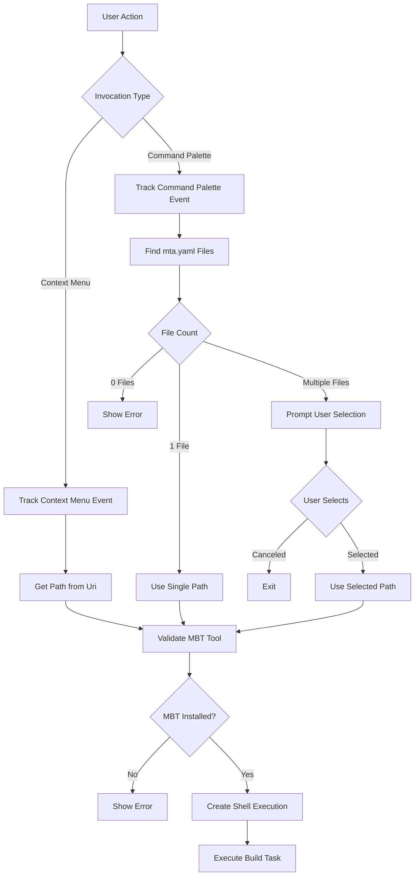
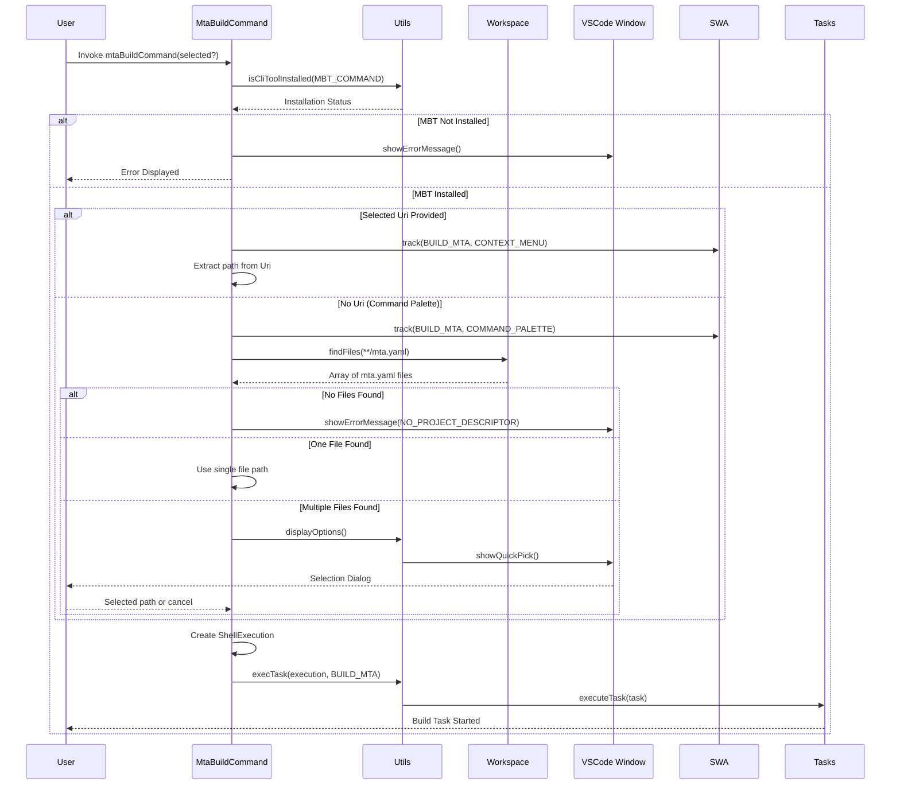
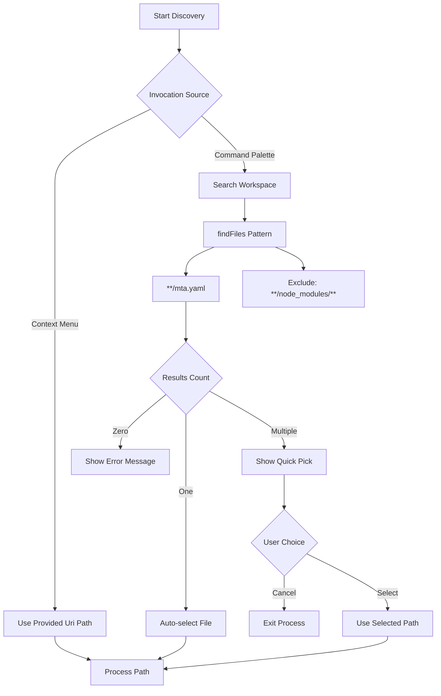
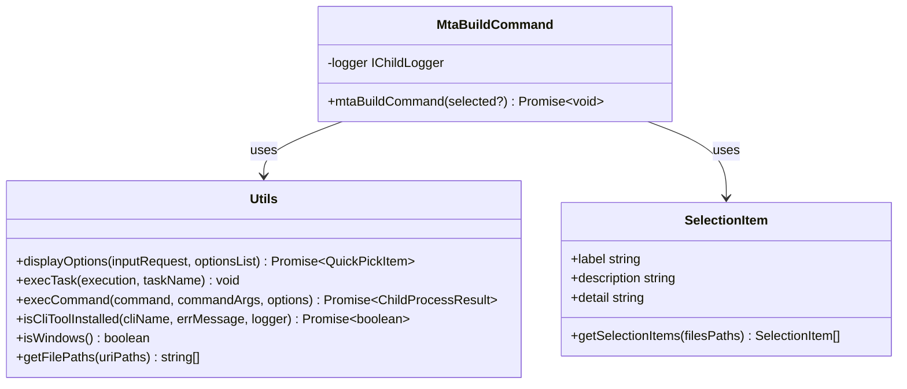
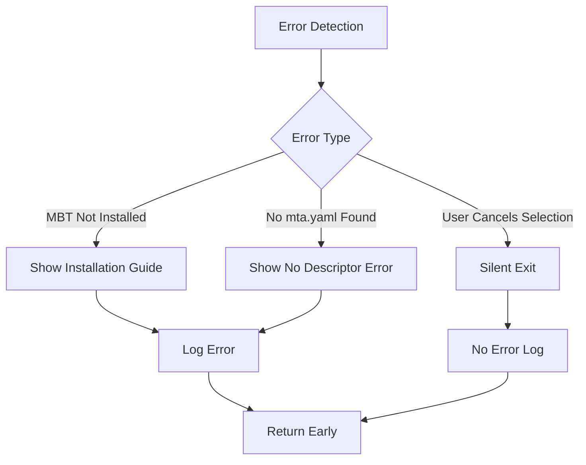

# MTA Build Command

## Introduction

The MTA Build Command is a core feature of the vscode-mta-tools extension that enables developers to build SAP Multi-Target Application (MTA) projects directly from Visual Studio Code. This command provides a convenient interface to the Cloud MTA Build Tool (MBT), allowing users to trigger builds either through the command palette or via context menu actions on `mta.yaml` files. The command handles automatic detection of MTA project descriptors, validates the presence of required build tools, and executes build tasks with proper workspace integration and usage analytics tracking.

Sources: [src/commands/mtaBuildCommand.ts:1-102](../../../src/commands/mtaBuildCommand.ts#L1-L102)

## Architecture and Components

### MtaBuildCommand Class

The `MtaBuildCommand` class serves as the primary entry point for MTA build operations. It encapsulates the build logic and integrates with VS Code's task system, logging infrastructure, and analytics tracking.



The class includes a logger instance for tracking operations and debugging:

```typescript
private readonly logger: IChildLogger = getClassLogger(MtaBuildCommand.name);
```

Sources: [src/commands/mtaBuildCommand.ts:17-19](../../../src/commands/mtaBuildCommand.ts#L17-L19)

### Build Command Execution Flow

The `mtaBuildCommand` method orchestrates the entire build process through several key stages:



Sources: [src/commands/mtaBuildCommand.ts:21-95](../../../src/commands/mtaBuildCommand.ts#L21-L95), [src/utils/utils.ts:1-170](../../../src/utils/utils.ts#L1-L170)

## Key Features and Functionality

### MBT Tool Validation

Before executing any build operation, the command verifies that the Cloud MTA Build Tool (MBT) is installed in the user's environment:

| Feature            | Description                                      | Error Handling                                                |
| ------------------ | ------------------------------------------------ | ------------------------------------------------------------- |
| Tool Detection     | Executes `mbt -v` command to verify installation | Returns false if exit code is "ENOENT"                        |
| Error Message      | Displays user-friendly installation instructions | Shows message: "The Cloud MTA Build Tool is not installed..." |
| Logger Integration | Records tool installation status                 | Logs error when tool is not found                             |

Sources: [src/commands/mtaBuildCommand.ts:23-30](../../../src/commands/mtaBuildCommand.ts#L23-L30), [src/utils/utils.ts:87-100](../../../src/utils/utils.ts#L87-L100), [src/i18n/messages.ts:22-24](../../../src/i18n/messages.ts#L22-L24)

### Project Descriptor Discovery

The command implements intelligent discovery of MTA project descriptors with multiple scenarios:



Sources: [src/commands/mtaBuildCommand.ts:31-68](../../../src/commands/mtaBuildCommand.ts#L31-L68)

### Usage Analytics Tracking

The command integrates with SAP Web Analytics (SWA) to track user interactions and usage patterns:

| Event Type | Custom Event    | Trigger Condition                                  |
| ---------- | --------------- | -------------------------------------------------- |
| Build MTA  | Context Menu    | User invokes build from file explorer context menu |
| Build MTA  | Command Palette | User invokes build from VS Code command palette    |

```typescript
getSWA().track(messages.EVENT_TYPE_BUILD_MTA, [
  messages.CUSTOM_EVENT_CONTEXT_MENU,
]);
```

Sources: [src/commands/mtaBuildCommand.ts:33-35](../../../src/commands/mtaBuildCommand.ts#L33-L35), [src/commands/mtaBuildCommand.ts:39-41](../../../src/commands/mtaBuildCommand.ts#L39-L41), [src/i18n/messages.ts:27-30](../../../src/i18n/messages.ts#L27-L30)

### Shell Execution Configuration

The build command constructs a shell execution with specific parameters to invoke the MBT tool:

```typescript
const options: ShellExecutionOptions = { cwd: homeDir };
const execution = new ShellExecution(
  MBT_COMMAND +
    " build -s " +
    "'" +
    replace(path, "/mta.yaml", "") +
    "'; sleep 2;",
  options
);
```

| Component         | Value                    | Purpose                         |
| ----------------- | ------------------------ | ------------------------------- |
| Command           | `mbt`                    | Cloud MTA Build Tool executable |
| Build Flag        | `-s`                     | Source directory flag           |
| Working Directory | `os.homedir()`           | User's home directory           |
| Path Processing   | Strip `/mta.yaml` suffix | Extract project root directory  |
| Post-command      | `sleep 2`                | Allow task output to complete   |

Sources: [src/commands/mtaBuildCommand.ts:73-82](../../../src/commands/mtaBuildCommand.ts#L73-L82), [src/commands/mtaBuildCommand.ts:13](../../../src/commands/mtaBuildCommand.ts#L13)

## Utility Functions and Helper Classes

### Utils Class Methods

The `Utils` class provides essential helper functions used by the MTA Build Command:



#### Key Utility Methods

**displayOptions**: Presents a quick pick dialog for user selection

```typescript
public static async displayOptions(
  inputRequest: string,
  optionsList: QuickPickItem[]
): Promise<QuickPickItem | undefined>
```

**execTask**: Creates and executes a VS Code task

```typescript
public static execTask(execution: ShellExecution, taskName: string): void {
  const task = new Task(
    { type: "shell" },
    TaskScope.Workspace,
    taskName,
    "MTA",
    execution
  );
  void tasks.executeTask(task);
}
```

**isCliToolInstalled**: Validates CLI tool availability

```typescript
public static async isCliToolInstalled(
  cliName: string,
  errMessage: string,
  logger: IChildLogger
): Promise<boolean>
```

Sources: [src/utils/utils.ts:21-35](../../../src/utils/utils.ts#L21-L35), [src/utils/utils.ts:55-66](../../../src/utils/utils.ts#L55-L66), [src/utils/utils.ts:87-100](../../../src/utils/utils.ts#L87-L100)

### SelectionItem Class

The `SelectionItem` class wraps file paths into VS Code QuickPickItem objects for user selection:

| Property    | Type               | Purpose                  |
| ----------- | ------------------ | ------------------------ |
| label       | string             | Display text (file path) |
| description | string (optional)  | Additional context       |
| detail      | string (optional)  | Detailed information     |
| picked      | boolean (optional) | Pre-selection state      |
| alwaysShow  | boolean (optional) | Visibility control       |

Sources: [src/utils/selectionItem.ts:1-27](../../../src/utils/selectionItem.ts#L1-L27)

## Platform-Specific Handling

The command includes platform-specific path handling for Windows compatibility:

```typescript
path = Utils.isWindows() ? trimStart(path, "/") : path;
```

The `isWindows()` utility method detects the operating system:

```typescript
public static isWindows(): boolean {
  return os.platform().indexOf("win") > -1;
}
```

This ensures that file paths are correctly formatted for the underlying operating system, particularly removing leading slashes on Windows systems where they are not valid.

Sources: [src/commands/mtaBuildCommand.ts:71-72](../../../src/commands/mtaBuildCommand.ts#L71-L72), [src/utils/utils.ts:79-81](../../../src/utils/utils.ts#L79-L81)

## Error Handling and Validation

### Error Scenarios

The command handles multiple error conditions with appropriate user feedback:



| Error Condition        | Message                 | User Action Required                     |
| ---------------------- | ----------------------- | ---------------------------------------- |
| MBT Tool Missing       | `INSTALL_MBT`           | Install Cloud MTA Build Tool from GitHub |
| No Project Descriptor  | `NO_PROJECT_DESCRIPTOR` | Create or locate mta.yaml file           |
| User Cancels Selection | None (silent)           | No action required                       |

Sources: [src/commands/mtaBuildCommand.ts:23-30](../../../src/commands/mtaBuildCommand.ts#L23-L30), [src/commands/mtaBuildCommand.ts:46-49](../../../src/commands/mtaBuildCommand.ts#L46-L49), [src/commands/mtaBuildCommand.ts:62-65](../../../src/commands/mtaBuildCommand.ts#L62-L65)

## Testing Strategy

The test suite for MTA Build Command covers comprehensive scenarios:

### Test Coverage

| Test Scenario           | Validation                               | Mock Components                 |
| ----------------------- | ---------------------------------------- | ------------------------------- |
| Context Menu Invocation | Verifies SWA tracking and task execution | Utils, Tasks, SWA               |
| No mta.yaml Files       | Validates error message display          | Workspace, Window               |
| Single mta.yaml File    | Confirms automatic selection             | Workspace, Tasks                |
| Multiple mta.yaml Files | Tests user selection flow                | Workspace, Utils, SelectionItem |
| User Cancels Selection  | Ensures graceful exit                    | Workspace, Utils                |
| MBT Not Installed       | Verifies error handling                  | Utils, Window                   |

Sources: [tests/commands/mtaBuildCommand.spec.ts:1-164](../../../tests/commands/mtaBuildCommand.spec.ts#L1-L164)

### Test Implementation Example

```typescript
it("mtaBuildCommand - build MTA from context menu", async () => {
  utilsMock
    .expects("execCommand")
    .once()
    .withExactArgs(MBT_CMD, ["-v"], { cwd: homeDir })
    .returns("v1.2.3");
  tasksMock.expects("executeTask").once().withExactArgs(buildTask);
  await mtaBuildCommand.mtaBuildCommand(selected as Uri);
  expect(swaEventType).to.equal(messages.EVENT_TYPE_BUILD_MTA);
  expect(swaCustomEvents).to.deep.equal([messages.CUSTOM_EVENT_CONTEXT_MENU]);
});
```

Sources: [tests/commands/mtaBuildCommand.spec.ts:67-77](../../../tests/commands/mtaBuildCommand.spec.ts#L67-L77)

## Internationalization Support

The command utilizes centralized message definitions for consistent user-facing text and analytics events:

```typescript
export const messages = {
  BUILD_MTA: "Build MTA Project",
  SELECT_PROJECT_DESCRIPTOR:
    "Select the folder containing the MTA project descriptor file (mta.yaml)",
  NO_PROJECT_DESCRIPTOR:
    "Could not find a folder containing an MTA project descriptor file (mta.yaml).",
  INSTALL_MBT:
    "The Cloud MTA Build Tool is not installed in your environment...",
  EVENT_TYPE_BUILD_MTA: "Build MTA",
  CUSTOM_EVENT_CONTEXT_MENU: "Context Menu",
  CUSTOM_EVENT_COMMAND_PALETTE: "Command Palette",
};
```

Sources: [src/i18n/messages.ts:6-30](../../../src/i18n/messages.ts#L6-L30)

## Summary

The MTA Build Command provides a robust, user-friendly interface for building SAP Multi-Target Applications within Visual Studio Code. It seamlessly integrates with the Cloud MTA Build Tool, handles multiple project scenarios, tracks usage analytics, and provides comprehensive error handling. The command's architecture emphasizes modularity through utility classes, proper logging infrastructure, and extensive test coverage, ensuring reliable operation across different user workflows and platform environments.
