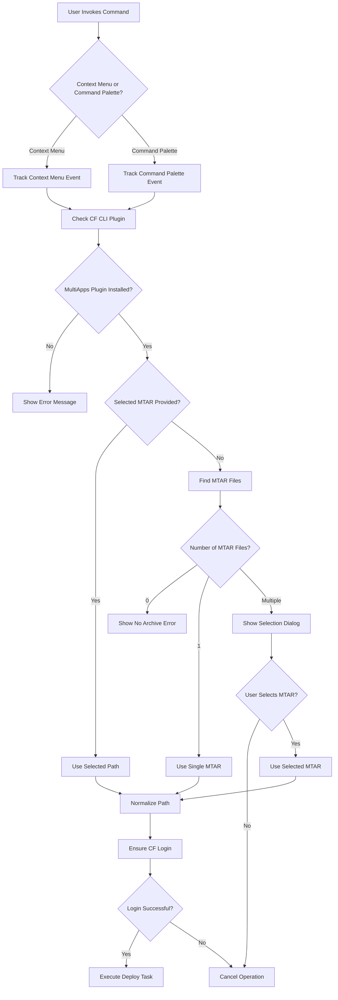
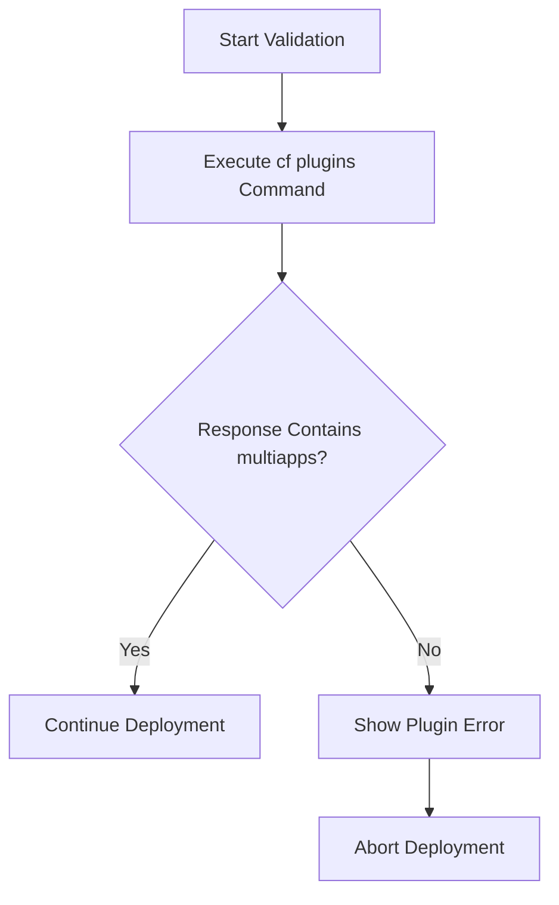
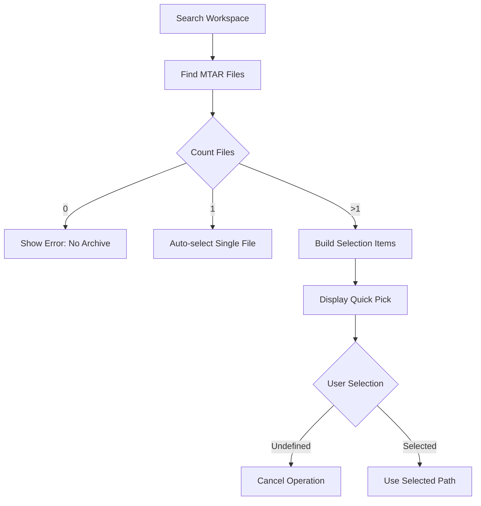
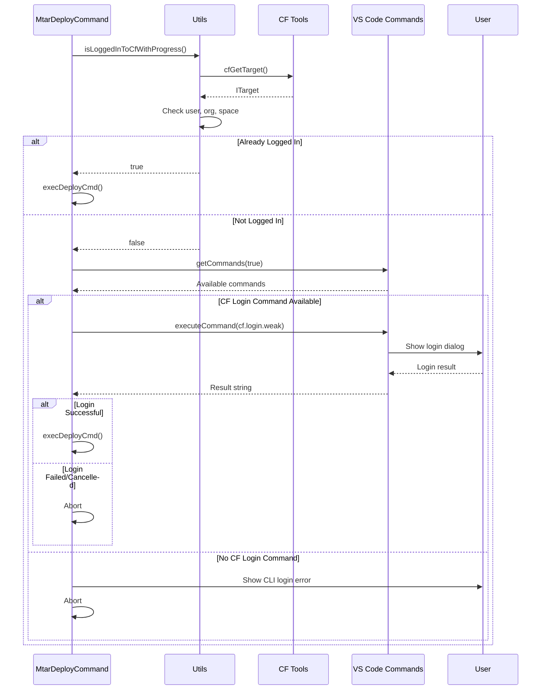
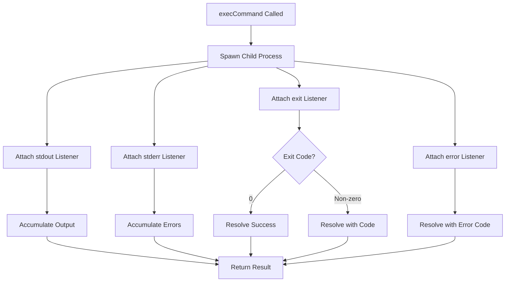

# MTAR Deploy Command

## Introduction

The MTAR Deploy Command is a core feature of the vscode-mta-tools extension that enables developers to deploy Multi-Target Application (MTA) archives (.mtar files) to Cloud Foundry environments directly from Visual Studio Code. This command provides a streamlined workflow for deploying MTA projects by automatically detecting available MTAR files in the workspace, verifying the necessary Cloud Foundry CLI tools and plugins are installed, ensuring the user is authenticated to Cloud Foundry, and executing the deployment process. The command can be invoked either through the VS Code command palette or via the context menu on MTAR files, and includes comprehensive error handling, user guidance, and analytics tracking to ensure a smooth deployment experience.

Sources: [src/commands/mtarDeployCommand.ts:1-120](../../../src/commands/mtarDeployCommand.ts#L1-L120)

## Architecture Overview

The MTAR Deploy Command follows a modular architecture with clear separation of concerns. The `MtarDeployCommand` class serves as the primary orchestrator, coordinating interactions between the VS Code API, Cloud Foundry CLI, utility functions, and user interface components. The command leverages several utility classes and external dependencies to perform its operations.



Sources: [src/commands/mtarDeployCommand.ts:24-119](../../../src/commands/mtarDeployCommand.ts#L24-L119), [tests/commands/mtarDeployCommand.spec.ts:1-292](../../../tests/commands/mtarDeployCommand.spec.ts#L1-L292)

## Key Components

### MtarDeployCommand Class

The `MtarDeployCommand` class is the primary component responsible for orchestrating the MTAR deployment process. It includes a logger instance for tracking operations and error handling.

| Component              | Type           | Description                                                |
| ---------------------- | -------------- | ---------------------------------------------------------- |
| `logger`               | `IChildLogger` | Logger instance for tracking command execution and errors  |
| `mtarDeployCommand()`  | Method         | Main entry point that orchestrates the deployment workflow |
| `ensureLoggedInToCF()` | Method         | Verifies or establishes Cloud Foundry authentication       |
| `execDeployCmd()`      | Method         | Executes the actual CF deployment command                  |

Sources: [src/commands/mtarDeployCommand.ts:17-22](../../../src/commands/mtarDeployCommand.ts#L17-L22)

### Constants and Configuration

The command relies on several constants for Cloud Foundry integration:

```typescript
const CF_COMMAND = "cf";
const CF_LOGIN_COMMAND = "cf.login.weak";
const homeDir = os.homedir();
```

These constants define the Cloud Foundry CLI command name, the weak login command for authentication, and the home directory for executing commands.

Sources: [src/commands/mtarDeployCommand.ts:14-16](../../../src/commands/mtarDeployCommand.ts#L14-L16)

## Deployment Workflow

### Prerequisites Validation

The deployment process begins by validating that the MultiApps Cloud Foundry CLI plugin is installed. This is accomplished by executing the `cf plugins --checksum` command and checking if "multiapps" appears in the output.



If the plugin is not detected, the user is presented with an error message directing them to install the MultiApps CF CLI Plugin from the official GitHub repository.

Sources: [src/commands/mtarDeployCommand.ts:25-31](../../../src/commands/mtarDeployCommand.ts#L25-L31), [src/i18n/messages.ts:24-26](../../../src/i18n/messages.ts#L24-L26)

### MTAR File Selection

The command supports two invocation methods, each with different MTAR file selection logic:

#### Context Menu Invocation

When invoked from the context menu on a file, the selected URI is directly used as the MTAR path. The command tracks this usage through analytics.

```typescript
if (selected) {
  getSWA().track(messages.EVENT_TYPE_DEPLOY_MTAR, [
    messages.CUSTOM_EVENT_CONTEXT_MENU,
  ]);
  path = selected.path;
}
```

Sources: [src/commands/mtarDeployCommand.ts:35-40](../../../src/commands/mtarDeployCommand.ts#L35-L40)

#### Command Palette Invocation

When invoked from the command palette, the command searches the workspace for all MTAR files and handles three scenarios:

| Scenario                  | Behavior                         |
| ------------------------- | -------------------------------- |
| No MTAR files found       | Display error message and abort  |
| Single MTAR file found    | Automatically use that file      |
| Multiple MTAR files found | Present selection dialog to user |



Sources: [src/commands/mtarDeployCommand.ts:42-68](../../../src/commands/mtarDeployCommand.ts#L42-L68)

### Path Normalization

After selecting the MTAR file, the path is normalized based on the operating system. On Windows platforms, the leading forward slash is trimmed to ensure compatibility with the file system.

```typescript
path = Utils.isWindows() ? trimStart(path, "/") : path;
```

Sources: [src/commands/mtarDeployCommand.ts:69](../../../src/commands/mtarDeployCommand.ts#L69)

## Cloud Foundry Authentication

### Authentication Verification Flow

The command ensures the user is authenticated to Cloud Foundry before attempting deployment. The authentication flow is handled by the `ensureLoggedInToCF()` method.



Sources: [src/commands/mtarDeployCommand.ts:75-95](../../../src/commands/mtarDeployCommand.ts#L75-L95), [src/utils/utils.ts:101-128](../../../src/utils/utils.ts#L101-L128)

### Authentication Methods

The command supports two authentication approaches:

1. **Weak Login Command**: If the `cf.login.weak` command is available (provided by the CF Tools extension), it executes this command to prompt the user for credentials through a VS Code dialog.

2. **CLI Login Fallback**: If the weak login command is not available, the user is instructed to authenticate using the Cloud Foundry CLI directly from the terminal.

Sources: [src/commands/mtarDeployCommand.ts:82-93](../../../src/commands/mtarDeployCommand.ts#L82-L93)

### Login Status Check

The `Utils.isLoggedInToCfWithProgress()` method wraps the authentication check with a progress notification to provide user feedback during the verification process.

```typescript
public static async isLoggedInToCfWithProgress(): Promise<boolean> {
  return window.withProgress(
    {
      location: ProgressLocation.Notification,
      title: "Checking your connection to Cloud Foundry...",
      cancellable: false,
    },
    this.isLoggedInToCf
  );
}
```

The underlying `isLoggedInToCf()` method retrieves the CF target and validates that the user, organization, and space are all populated, indicating an active session.

Sources: [src/utils/utils.ts:119-128](../../../src/utils/utils.ts#L119-L128), [src/utils/utils.ts:107-117](../../../src/utils/utils.ts#L107-L117)

## Deployment Execution

### Task Creation and Execution

Once all prerequisites are validated and authentication is confirmed, the command creates and executes a VS Code task to perform the actual deployment. The task is configured with a shell execution that runs the Cloud Foundry deploy command.

```typescript
private async execDeployCmd(path: string): Promise<void> {
  const options: ShellExecutionOptions = { cwd: homeDir };
  const execution = new ShellExecution(
    CF_COMMAND + ' deploy "' + path + '"',
    options
  );
  this.logger.info(`Deploy MTA Archive starts`);
  Utils.execTask(execution, messages.DEPLOY_MTAR);
}
```

The deployment command is executed from the user's home directory, and the MTAR path is properly quoted to handle paths with spaces or special characters.

Sources: [src/commands/mtarDeployCommand.ts:97-106](../../../src/commands/mtarDeployCommand.ts#L97-L106)

### Task Configuration

The `Utils.execTask()` method creates a VS Code task with the following configuration:

| Property  | Value                | Description                             |
| --------- | -------------------- | --------------------------------------- |
| Type      | "shell"              | Indicates a shell execution task        |
| Scope     | TaskScope.Workspace  | Task is scoped to the current workspace |
| Name      | "Deploy MTA Archive" | Display name shown in the task panel    |
| Source    | "MTA"                | Task provider identifier                |
| Execution | ShellExecution       | The shell command to execute            |

```typescript
public static execTask(execution: ShellExecution, taskName: string): void {
  const task = new Task(
    { type: "shell" },
    TaskScope.Workspace,
    taskName,
    "MTA",
    execution
  );

  void tasks.executeTask(task);
}
```

Sources: [src/utils/utils.ts:44-54](../../../src/utils/utils.ts#L44-L54)

## User Interface Components

### Selection Dialog

When multiple MTAR files are found, the command presents a quick pick dialog using the `SelectionItem` class to format the options.

```typescript
export class SelectionItem implements QuickPickItem {
  public static getSelectionItems(filesPaths: Uri[]): SelectionItem[] {
    return map(filesPaths, (uri) => {
      return new SelectionItem(uri.path, "", "");
    });
  }
  public label: string;
  public description?: string;
  public detail?: string;
  public picked?: boolean;
  public alwaysShow?: boolean;
}
```

The dialog is configured with the following options:

- **Placeholder**: "Select MTA Archive"
- **Can Pick Many**: false (single selection only)
- **Match On Detail**: true (enables searching by detail text)
- **Ignore Focus Out**: true (prevents accidental dismissal)

Sources: [src/utils/selectionItem.ts:1-23](../../../src/utils/selectionItem.ts#L1-L23), [src/utils/utils.ts:21-32](../../../src/utils/utils.ts#L21-L32)

### Error Messages

The command displays context-specific error messages for various failure scenarios:

| Scenario                          | Message                                                                                                                                                                       |
| --------------------------------- | ----------------------------------------------------------------------------------------------------------------------------------------------------------------------------- |
| MultiApps plugin not installed    | "The MultiApps CF CLI Plugin is not installed in your environment. Go to https://github.com/cloudfoundry-incubator/multiapps-cli-plugin to install the plugin and try again." |
| No MTAR files found               | "Could not find an MTA archive."                                                                                                                                              |
| CF login required (no weak login) | "You must log into Cloud Foundry using the Cloud Foundry CLI to deploy your MTA archive. Go to https://github.com/cloudfoundry/cli to install the CLI and try again"          |

Sources: [src/i18n/messages.ts:11-26](../../../src/i18n/messages.ts#L11-L26)

## Analytics and Telemetry

The command integrates with the Software Analytics (SWA) tracking system to monitor usage patterns. Analytics events are tracked based on the invocation method:

```typescript
// Context menu invocation
getSWA().track(messages.EVENT_TYPE_DEPLOY_MTAR, [
  messages.CUSTOM_EVENT_CONTEXT_MENU,
]);

// Command palette invocation
getSWA().track(messages.EVENT_TYPE_DEPLOY_MTAR, [
  messages.CUSTOM_EVENT_COMMAND_PALETTE,
]);
```

The event types and custom events are defined in the messages configuration:

- **Event Type**: "Deploy mtar"
- **Custom Events**: "Context Menu" or "Command Palette"

Sources: [src/commands/mtarDeployCommand.ts:36-38](../../../src/commands/mtarDeployCommand.ts#L36-L38), [src/commands/mtarDeployCommand.ts:43-45](../../../src/commands/mtarDeployCommand.ts#L43-L45), [src/i18n/messages.ts:29-32](../../../src/i18n/messages.ts#L29-L32)

## Utility Functions

### Command Execution

The `Utils.execCommand()` method provides a promise-based wrapper around Node.js child process spawning for executing external commands:



The method returns a `ChildProcessResult` object containing the exit code, stdout, and stderr output.

Sources: [src/utils/utils.ts:56-99](../../../src/utils/utils.ts#L56-L99)

### Platform Detection

The command uses the `Utils.isWindows()` method to detect the operating system and adjust path handling accordingly:

```typescript
public static isWindows(): boolean {
  return os.platform().indexOf("win") > -1;
}
```

This ensures that file paths are correctly formatted for the target platform before being passed to the Cloud Foundry CLI.

Sources: [src/utils/utils.ts:101-103](../../../src/utils/utils.ts#L101-L103)

## Error Handling and Logging

The command implements comprehensive error handling and logging throughout the deployment workflow:

### Logger Integration

The `MtarDeployCommand` class initializes a child logger using the `getClassLogger()` function, which provides structured logging capabilities:

```typescript
private readonly logger: IChildLogger = getClassLogger(
  MtarDeployCommand.name
);
```

Sources: [src/commands/mtarDeployCommand.ts:18-20](../../../src/commands/mtarDeployCommand.ts#L18-L20)

### Error Scenarios

The command logs and handles the following error conditions:

1. **Missing MultiApps Plugin**: Logs error and displays message to user
2. **No MTAR Files Found**: Logs error with message key and displays error dialog
3. **Authentication Failure**: Returns false from `ensureLoggedInToCF()` to prevent deployment
4. **User Cancellation**: Silently returns without error when user cancels selection

Sources: [src/commands/mtarDeployCommand.ts:28-31](../../../src/commands/mtarDeployCommand.ts#L28-L31), [src/commands/mtarDeployCommand.ts:48-51](../../../src/commands/mtarDeployCommand.ts#L48-L51)

## Testing Coverage

The command includes comprehensive unit tests covering all major scenarios and edge cases:

### Test Scenarios

| Test Case               | Description                                                   |
| ----------------------- | ------------------------------------------------------------- |
| Context menu deployment | Verifies deployment from context menu with analytics tracking |
| Context menu on Windows | Tests Windows-specific path handling                          |
| No MTAR found           | Validates error handling when no archives exist               |
| Single MTAR auto-select | Tests automatic selection with one archive                    |
| Multiple MTAR selection | Validates selection dialog with multiple archives             |
| Selection cancellation  | Tests graceful handling of user cancellation                  |
| Missing plugin          | Verifies error when MultiApps plugin not installed            |
| Login cancellation      | Tests handling when user cancels login                        |
| Successful login flow   | Validates complete authentication and deployment              |
| CLI login fallback      | Tests fallback to CLI when weak login unavailable             |

Sources: [tests/commands/mtarDeployCommand.spec.ts:41-292](../../../tests/commands/mtarDeployCommand.spec.ts#L41-L292)

### Mock Framework

The tests utilize Sinon for mocking VS Code APIs, utilities, and external dependencies. The test suite creates comprehensive mocks for:

- `Utils` class methods
- VS Code `window`, `workspace`, `commands`, and `tasks` APIs
- `SelectionItem` static methods
- Logger wrapper functions
- SWA tracker

Sources: [tests/commands/mtarDeployCommand.spec.ts:48-66](../../../tests/commands/mtarDeployCommand.spec.ts#L48-L66)

## Summary

The MTAR Deploy Command provides a robust, user-friendly solution for deploying Multi-Target Application archives to Cloud Foundry from within VS Code. It handles the complete deployment workflow including prerequisite validation, MTAR file selection, authentication management, and task execution. The command's architecture emphasizes modularity, comprehensive error handling, and user experience through progress notifications, clear error messages, and flexible invocation methods. With full test coverage and analytics integration, the command ensures reliable deployments while providing valuable usage insights for continuous improvement.

Sources: [src/commands/mtarDeployCommand.ts:1-120](../../../src/commands/mtarDeployCommand.ts#L1-L120), [src/utils/utils.ts:1-134](../../../src/utils/utils.ts#L1-L134), [src/i18n/messages.ts:1-73](../../../src/i18n/messages.ts#L1-L73)
