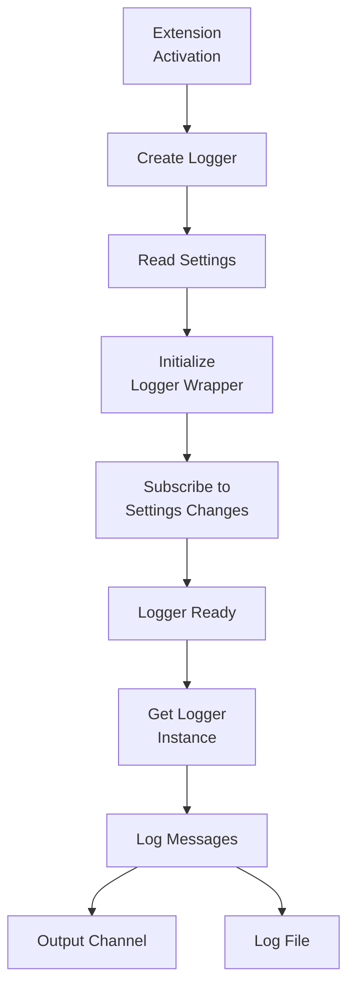
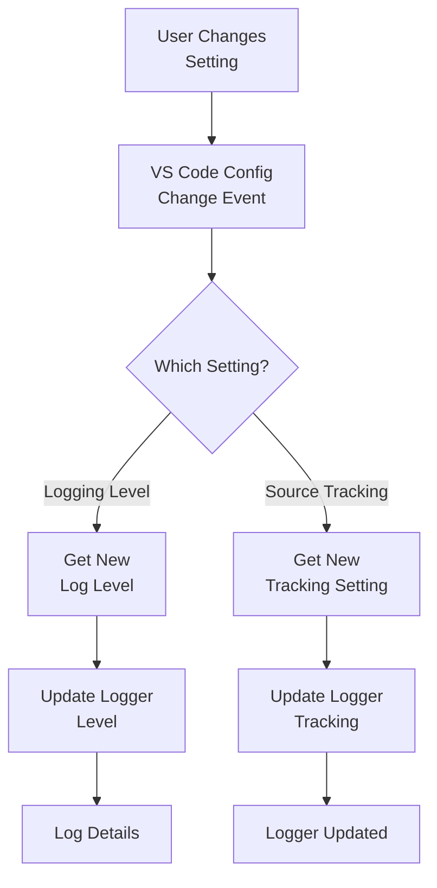
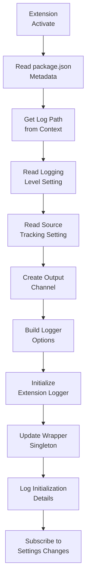
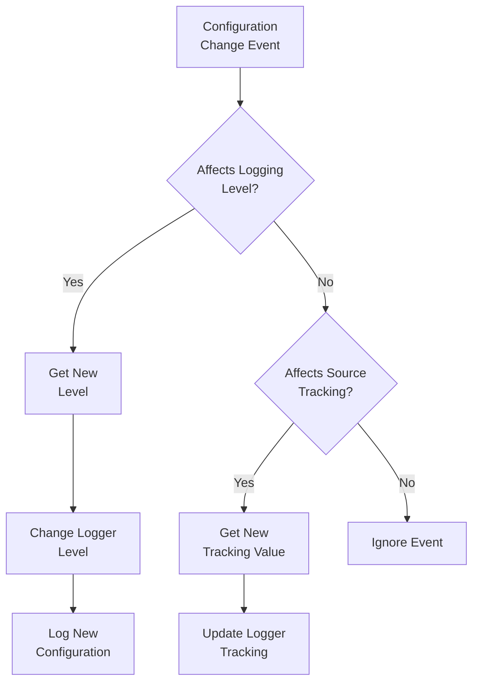

# Logging System

The Logging System is a critical infrastructure component of the vscode-mta-tools extension that provides comprehensive logging capabilities for debugging, monitoring, and troubleshooting SAP Multi-Target Application (MTA) operations. Built on top of the `@vscode-logging/logger` library, it implements a singleton pattern with dynamic configuration support, enabling developers and users to control logging verbosity and track source locations. The system integrates seamlessly with VS Code's output channels and file-based logging, ensuring logs are accessible both within the IDE and on the file system for post-mortem analysis.

Sources: [logger/logger-wrapper.ts:1-85](../../../src/logger/logger-wrapper.ts#L1-L85), [logger/settings.ts:1-23](../../../src/logger/settings.ts#L1-L23)

## Architecture Overview

The Logging System follows a modular architecture with clear separation of concerns across four primary components: the logger wrapper (singleton management), settings management (configuration retrieval), settings change handlers (dynamic reconfiguration), and an empty logger fallback (safe initialization).



The architecture ensures that the logger is initialized early during extension activation and remains accessible throughout the extension's lifecycle through getter functions. The system supports both parent and child loggers, enabling hierarchical logging with contextual labels.

Sources: [logger/logger-wrapper.ts:48-85](../../../src/logger/logger-wrapper.ts#L48-L85), [logger/settings-changes-handler.ts:1-44](../../../src/logger/settings-changes-handler.ts#L1-L44)

## Core Components

### Logger Wrapper

The logger wrapper (`logger-wrapper.ts`) implements the singleton pattern to maintain a single `IVSCodeExtLogger` instance throughout the extension's lifecycle. It provides convenient accessor functions for retrieving the main logger or creating child loggers with specific labels.

| Function                                                         | Return Type        | Purpose                                                        |
| ---------------------------------------------------------------- | ------------------ | -------------------------------------------------------------- |
| `getLogger()`                                                    | `IVSCodeExtLogger` | Returns the singleton logger instance                          |
| `getClassLogger(className)`                                      | `IChildLogger`     | Creates a child logger with a class-specific label             |
| `createExtensionLoggerAndSubscribeToLogSettingsChanges(context)` | `void`             | Initializes the logger and subscribes to configuration changes |

The wrapper initializes with an `EMPTY_LOGGER` to prevent null reference errors before proper initialization, ensuring safe usage even if the logger setup fails.

Sources: [logger/logger-wrapper.ts:23-47](../../../src/logger/logger-wrapper.ts#L23-L47), [logger/empty-logger.ts:1-23](../../../src/logger/empty-logger.ts#L1-L23)

### Settings Management

The settings module (`settings.ts`) provides a centralized interface for retrieving logging configuration from VS Code's workspace settings. It defines configuration property names that must match those declared in the extension's `package.json`.

| Configuration Property             | Type       | Default Value | Description                                                   |
| ---------------------------------- | ---------- | ------------- | ------------------------------------------------------------- |
| `MTA Tools.loggingLevel`           | `LogLevel` | `"error"`     | Controls the minimum severity level for logged messages       |
| `MTA Tools.sourceLocationTracking` | `boolean`  | `false`       | Enables/disables source file and line number tracking in logs |

```typescript
export function getLoggingLevelSetting(): LogLevel {
  return workspace.getConfiguration().get(LOGGING_LEVEL_CONFIG_PROP) ?? "error";
}

export function getSourceLocationTrackingSetting(): boolean {
  return workspace.getConfiguration().get(SOURCE_TRACKING_CONFIG_PROP) ?? false;
}
```

Sources: [logger/settings.ts:1-23](../../../src/logger/settings.ts#L1-L23)

### Settings Change Handler

The settings change handler (`settings-changes-handler.ts`) implements reactive configuration updates by listening to VS Code's configuration change events. When users modify logging settings, the handler automatically updates the logger's behavior without requiring an extension reload.



The handler subscribes to two configuration properties and performs the following actions:

- **Logging Level Changes**: Updates the logger's minimum severity level and logs the new configuration
- **Source Location Tracking Changes**: Toggles source file and line number tracking in log entries

Sources: [logger/settings-changes-handler.ts:7-44](../../../src/logger/settings-changes-handler.ts#L7-L44)

### Empty Logger

The empty logger (`empty-logger.ts`) provides a null object implementation of the `IVSCodeExtLogger` interface. This fallback ensures that logging calls throughout the extension never fail, even if logger initialization encounters errors.

```typescript
export const EMPTY_LOGGER: IVSCodeExtLogger = {
  changeLevel(newLevel: string): void {},
  changeSourceLocationTracking(newSourceLocation: boolean): void {},
  debug(msg: string, ...args: any[]): void {},
  error(msg: string, ...args: any[]): void {},
  fatal(msg: string, ...args: any[]): void {},
  getChildLogger(opts: { label: string }): IChildLogger {
    return this;
  },
  info(msg: string, ...args: any[]): void {},
  trace(msg: string, ...args: any[]): void {},
  warn(msg: string, ...args: any[]): void {},
};
```

The empty logger is frozen to prevent accidental modifications and implements all required methods as no-ops, ensuring safe usage patterns throughout the codebase.

Sources: [logger/empty-logger.ts:1-23](../../../src/logger/empty-logger.ts#L1-L23)

## Initialization Flow

The logger initialization process follows a specific sequence during extension activation to ensure proper configuration and availability.



The initialization process performs the following steps:

1. **Metadata Extraction**: Reads the extension name from `package.json` for logger identification
2. **Path Resolution**: Obtains the log file path from the extension context
3. **Configuration Retrieval**: Fetches current logging level and source tracking settings
4. **Output Channel Creation**: Creates a VS Code output channel named "MTA" for in-IDE log viewing
5. **Logger Construction**: Builds the logger with all configuration options
6. **Wrapper Update**: Updates the singleton reference in the logger wrapper
7. **Initial Logging**: Logs the current configuration and log file location
8. **Change Subscription**: Registers listeners for configuration changes

Sources: [logger/logger-wrapper.ts:58-85](../../../src/logger/logger-wrapper.ts#L58-L85), [i18n/messages.ts:7](../../../src/i18n/messages.ts#L7)

## Logger Configuration

The logger is configured through the `getExtensionLoggerOpts` interface, which specifies all aspects of logging behavior.

| Configuration Option     | Type            | Source             | Purpose                           |
| ------------------------ | --------------- | ------------------ | --------------------------------- |
| `extName`                | `string`        | `package.json`     | Extension identifier in logs      |
| `level`                  | `LogLevel`      | User settings      | Minimum severity level to log     |
| `logConsole`             | `boolean`       | Hardcoded (`true`) | Enables console output            |
| `logPath`                | `string`        | Extension context  | File system path for log files    |
| `logOutputChannel`       | `OutputChannel` | VS Code API        | Output channel for in-IDE logs    |
| `sourceLocationTracking` | `boolean`       | User settings      | Enables source file/line tracking |

```typescript
const extensionLoggerOpts: getExtensionLoggerOpts = {
  extName: meta.name,
  level: logLevelSetting,
  logConsole: true,
  logPath: contextLogPath,
  logOutputChannel: window.createOutputChannel(messages.CHANNEL_NAME),
  sourceLocationTracking: sourceLocationTrackingSettings,
};
```

Sources: [logger/logger-wrapper.ts:64-82](../../../src/logger/logger-wrapper.ts#L64-L82)

## Usage Patterns

The Logging System supports two primary usage patterns for different contexts within the extension.

### Global Logger Access

For general logging throughout the extension, consumers call `getLogger()` to retrieve the singleton instance:

```typescript
import { getLogger } from "./logger/logger-wrapper";

getLogger().info(`Start Logging in Log Level: <${configLogLevel}>`);
getLogger().error("Extension activation failed", error);
```

Sources: [logger/logger-wrapper.ts:38-41](../../../src/logger/logger-wrapper.ts#L38-L41), [logger/settings-changes-handler.ts:12-15](../../../src/logger/settings-changes-handler.ts#L12-L15)

### Class-Specific Child Loggers

For class-based components, the system supports creating child loggers with contextual labels:

```typescript
import { getClassLogger } from "./logger/logger-wrapper";

const logger = getClassLogger("TaskProvider");
logger.debug("Processing task definition");
```

Child loggers inherit the parent logger's configuration but add a label for easier log filtering and analysis.

Sources: [logger/logger-wrapper.ts:43-45](../../../src/logger/logger-wrapper.ts#L43-L45)

## Integration with Task Providers

The Logging System is referenced throughout the extension's task provider messages, indicating its critical role in debugging MTA build and deployment operations. Task providers log various events and errors, including:

- Task auto-detection failures
- Validation errors for task parameters
- Cloud Foundry login status
- MTA Build Tool availability
- File discovery results
- Property configuration issues

The system ensures that even if logger initialization fails, task providers can continue operating through the empty logger fallback, with a specific error message indicating logs won't be available.

Sources: [i18n/messages.ts:33-85](../../../src/i18n/messages.ts#L33-L85)

## Dynamic Configuration Updates

The Logging System supports runtime configuration changes without requiring extension reload, enhancing developer experience during debugging sessions.



The dynamic update mechanism registers event handlers for both logging level and source location tracking changes, ensuring the logger immediately reflects user preferences.

Sources: [logger/settings-changes-handler.ts:17-44](../../../src/logger/settings-changes-handler.ts#L17-L44)

## Error Handling and Resilience

The Logging System implements multiple layers of error resilience:

1. **Empty Logger Fallback**: Prevents null pointer exceptions during initialization failures
2. **Default Configuration Values**: Provides sensible defaults (error level, tracking disabled) if settings are missing
3. **Frozen Empty Logger**: Prevents accidental modification of the fallback implementation
4. **Safe Getter Pattern**: Lazy resolution ensures the logger reference is always current

This defensive design ensures that logging failures never cascade into extension functionality failures, maintaining system stability even when diagnostic capabilities are compromised.

Sources: [logger/empty-logger.ts:1-23](../../../src/logger/empty-logger.ts#L1-L23), [logger/settings.ts:15-23](../../../src/logger/settings.ts#L15-L23), [i18n/messages.ts:1-4](../../../src/i18n/messages.ts#L1-L4)

## Summary

The Logging System provides a robust, configurable, and resilient infrastructure for diagnostic logging throughout the vscode-mta-tools extension. By implementing a singleton pattern with dynamic configuration support, it enables developers to adjust logging verbosity and behavior without disrupting active debugging sessions. The multi-layered architecture—spanning logger wrapper, settings management, change handlers, and fallback implementations—ensures reliable operation even under failure conditions. Integration with VS Code's output channels and file-based logging provides comprehensive log access for both real-time monitoring and post-mortem analysis, making it an essential component for maintaining and troubleshooting MTA project operations.

Sources: [logger/logger-wrapper.ts:1-85](../../../src/logger/logger-wrapper.ts#L1-L85), [logger/settings.ts:1-23](../../../src/logger/settings.ts#L1-L23), [logger/settings-changes-handler.ts:1-44](../../../src/logger/settings-changes-handler.ts#L1-L44), [logger/empty-logger.ts:1-23](../../../src/logger/empty-logger.ts#L1-L23), [i18n/messages.ts:1-85](../../../src/i18n/messages.ts#L1-L85)
