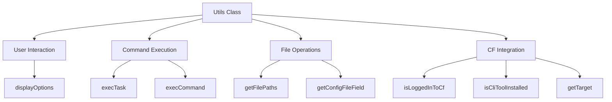
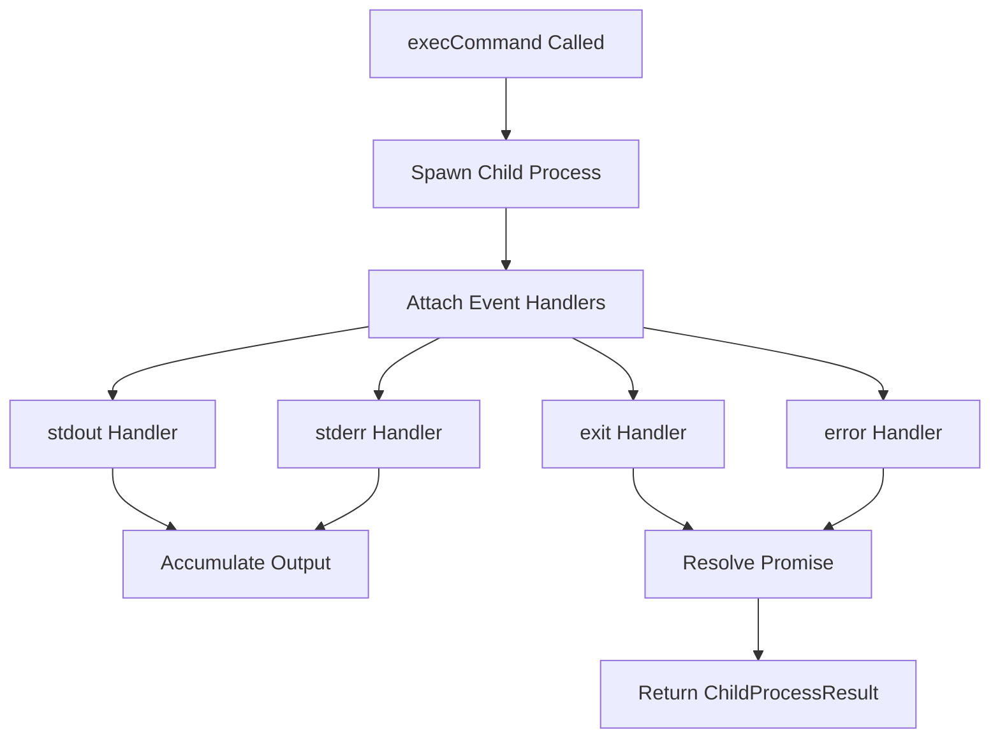
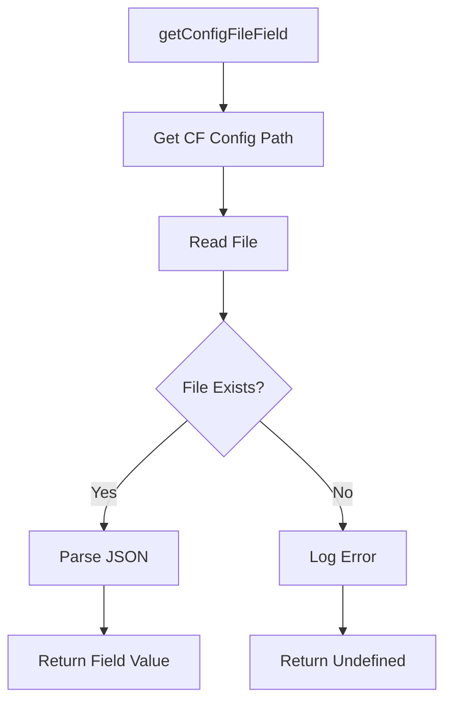
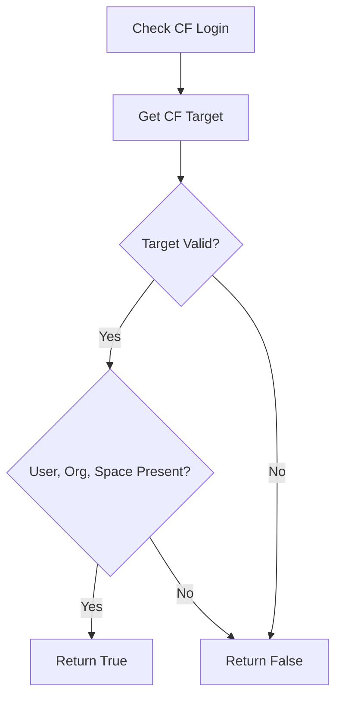
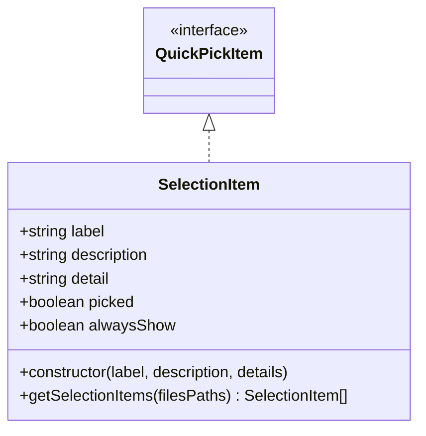
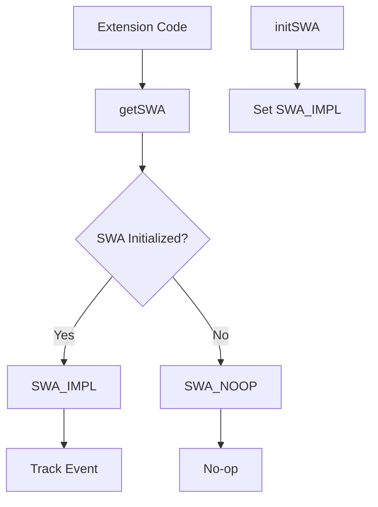
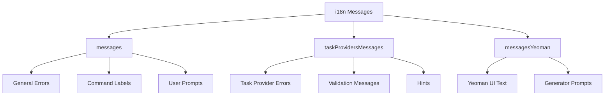
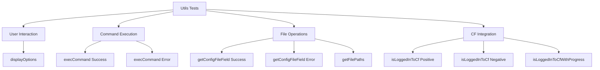

# Infrastructure: Utilities, SWA Tracking & i18n

This page documents the infrastructure components that provide foundational services across the vscode-mta-tools extension. These components include utility functions for common operations, Software Analytics (SWA) tracking integration for telemetry, and internationalization (i18n) message management. Together, they form the supporting layer that enables the extension's core features for building, deploying, and managing SAP Multi-Target Application (MTA) projects within Visual Studio Code.

The utilities module provides reusable functions for user interactions, command execution, file operations, and Cloud Foundry connectivity checks. The SWA tracking module enables usage analytics while maintaining a clean abstraction layer. The i18n messages module centralizes all user-facing strings and error messages, facilitating maintenance and potential future localization efforts.

## Utilities Module

The `Utils` class serves as the primary utility module, providing static methods for common operations throughout the extension. This includes user interaction helpers, command execution, file system operations, and Cloud Foundry integration checks.

Sources: [src/utils/utils.ts](../../../src/utils/utils.ts)

### Architecture Overview



### User Interaction Methods

The utilities module provides methods for displaying options to users and collecting input through VS Code's QuickPick interface.

| Method           | Parameters                                             | Return Type                           | Description                                                            |
| ---------------- | ------------------------------------------------------ | ------------------------------------- | ---------------------------------------------------------------------- |
| `displayOptions` | `inputRequest: string`, `optionsList: QuickPickItem[]` | `Promise<QuickPickItem \| undefined>` | Displays a QuickPick list with configurable options for user selection |

The `displayOptions` method configures the QuickPick with specific settings including focus retention, detail matching, and single-selection mode.

Sources: [src/utils/utils.ts:21-33](../../../src/utils/utils.ts#L21-L33)

```typescript
public static async displayOptions(
  inputRequest: string,
  optionsList: QuickPickItem[]
): Promise<QuickPickItem | undefined> {
  const options = {
    placeHolder: inputRequest,
    canPickMany: false,
    matchOnDetail: true,
    ignoreFocusOut: true,
  };
  return window.showQuickPick(optionsList, options);
}
```

Sources: [src/utils/utils.ts:21-33](../../../src/utils/utils.ts#L21-L33)

### Command Execution

The utilities module provides two distinct methods for executing commands: task-based execution for VS Code tasks and child process execution for direct command invocation.

#### Task Execution

The `execTask` method creates and executes VS Code tasks with shell execution:

```typescript
public static execTask(execution: ShellExecution, taskName: string): void {
  const task = new Task(
    { type: "shell" },
    TaskScope.Workspace,
    taskName,
    "MTA",
    execution
  );

  void tasks.executeTask(task);
}
```

Sources: [src/utils/utils.ts:47-58](../../../src/utils/utils.ts#L47-L58)

#### Child Process Execution

The `execCommand` method spawns child processes and captures their output, providing detailed execution results:



The method returns a `ChildProcessResult` type containing:

| Field      | Type               | Description                            |
| ---------- | ------------------ | -------------------------------------- |
| `exitCode` | `number \| string` | Process exit code or signal/error code |
| `stdout`   | `string`           | Standard output trimmed                |
| `stderr`   | `string`           | Standard error trimmed                 |

Sources: [src/utils/utils.ts:17-19](../../../src/utils/utils.ts#L17-L19), [src/utils/utils.ts:60-113](../../../src/utils/utils.ts#L60-L113)

### File System Operations

#### Path Handling

The `getFilePaths` method converts VS Code URI objects to file system paths, handling platform-specific path formatting:

```typescript
public static getFilePaths(uriPaths: Uri[]): string[] {
  return map(uriPaths, (uri) => {
    return Utils.isWindows() ? trimStart(uri.path, "/") : uri.path;
  });
}
```

On Windows platforms, the method removes leading slashes from paths to ensure compatibility with Windows file system conventions.

Sources: [src/utils/utils.ts:115-120](../../../src/utils/utils.ts#L115-L120)

#### Configuration File Access

The `getConfigFileField` method reads and parses Cloud Foundry configuration files:



The method locates the Cloud Foundry configuration file at `$CF_HOME/config.json` or defaults to `~/.cf/config.json`, then parses it using `comment-json` to support JSON with comments.

Sources: [src/utils/utils.ts:35-45](../../../src/utils/utils.ts#L35-L45), [src/utils/utils.ts:157-160](../../../src/utils/utils.ts#L157-L160)

### Cloud Foundry Integration

The utilities module provides several methods for checking Cloud Foundry connectivity and CLI tool availability.

#### CLI Tool Validation

The `isCliToolInstalled` method verifies CLI tool installation:

```typescript
public static async isCliToolInstalled(
  cliName: string,
  errMessage: string,
  logger: IChildLogger
): Promise<boolean> {
  const homeDir = os.homedir();
  const response = await Utils.execCommand(cliName, ["-v"], {
    cwd: homeDir,
  });
  if (response.exitCode === "ENOENT") {
    logger.error(`The ${cliName} Tool is not installed in the environment`);
    void window.showErrorMessage(errMessage);
    return false;
  }
  return true;
}
```

Sources: [src/utils/utils.ts:126-140](../../../src/utils/utils.ts#L126-L140)

#### Cloud Foundry Login Status

The module provides two methods for checking CF login status:

| Method                       | Description                                           | User Feedback                                        |
| ---------------------------- | ----------------------------------------------------- | ---------------------------------------------------- |
| `isLoggedInToCf`             | Checks CF connection by validating target information | None                                                 |
| `isLoggedInToCfWithProgress` | Same check with progress notification                 | Shows "Checking your connection to Cloud Foundry..." |



A valid login requires non-empty values for `user`, `org`, and `space` fields in the CF target information.

Sources: [src/utils/utils.ts:146-163](../../../src/utils/utils.ts#L146-L163)

### Platform Detection

The `isWindows` method provides platform detection for cross-platform compatibility:

```typescript
public static isWindows(): boolean {
  return os.platform().indexOf("win") > -1;
}
```

Sources: [src/utils/utils.ts:122-124](../../../src/utils/utils.ts#L122-L124)

## Selection Item

The `SelectionItem` class implements the VS Code `QuickPickItem` interface, providing a standardized way to create selectable items for user interactions.

### Class Structure



### Properties and Methods

| Property/Method     | Type      | Description                                    |
| ------------------- | --------- | ---------------------------------------------- |
| `label`             | `string`  | Primary display text                           |
| `description`       | `string`  | Optional secondary text                        |
| `detail`            | `string`  | Optional detailed information                  |
| `picked`            | `boolean` | Whether item is pre-selected                   |
| `alwaysShow`        | `boolean` | Whether to always show in filtered lists       |
| `getSelectionItems` | `static`  | Factory method to create items from URI arrays |

The static factory method `getSelectionItems` converts an array of VS Code URIs into SelectionItem instances, using the URI path as the label:

```typescript
public static getSelectionItems(filesPaths: Uri[]): SelectionItem[] {
  return map(filesPaths, (uri) => {
    return new SelectionItem(uri.path, "", "");
  });
}
```

Sources: [src/utils/selectionItem.ts](../../../src/utils/selectionItem.ts), [src/utils/selectionItem.ts:5-10](../../../src/utils/selectionItem.ts#L5-L10)

## SWA Tracking

The SWA (Software Analytics) tracking module provides a lightweight abstraction layer for usage analytics, allowing the extension to track user interactions while maintaining flexibility in the analytics implementation.

### Architecture



### Type Definitions

The module defines a minimal interface for tracking:

```typescript
export type ISWATracker = Pick<SWATracker, "track">;
```

This type extracts only the `track` method from the full `SWATracker` implementation, providing a focused interface.

Sources: [src/utils/swa.ts:5](../../../src/utils/swa.ts#L5)

### Implementation Pattern

The module uses a module-level variable to store the tracker implementation:

| Variable   | Type          | Initial Value        | Description                           |
| ---------- | ------------- | -------------------- | ------------------------------------- |
| `SWA_NOOP` | `ISWATracker` | No-op implementation | Default tracker that does nothing     |
| `SWA_IMPL` | `ISWATracker` | `SWA_NOOP`           | Current active tracker implementation |

### Public API

```typescript
export function initSWA(newSWA: ISWATracker): void {
  SWA_IMPL = newSWA;
}

export function getSWA(): ISWATracker {
  return SWA_IMPL;
}
```

The module provides two functions:

- `initSWA`: Initializes the tracker with a concrete implementation
- `getSWA`: Retrieves the current tracker for event tracking

This pattern ensures that tracking calls never fail, even if SWA is not initialized, by falling back to the no-op implementation.

Sources: [src/utils/swa.ts:7-18](../../../src/utils/swa.ts#L7-L18)

## Internationalization (i18n)

The i18n module centralizes all user-facing strings, error messages, and hints used throughout the extension. This organization facilitates maintenance and potential future localization efforts.

### Message Categories

The module exports three main message collections:



### General Messages

The `messages` object contains general extension messages:

| Category                  | Example Keys                                                         | Purpose                           |
| ------------------------- | -------------------------------------------------------------------- | --------------------------------- |
| Error Messages            | `ERROR_ACTIVATION_FAILED`, `NO_PROJECT_DESCRIPTOR`, `NO_MTA_ARCHIVE` | User-facing error notifications   |
| Command Labels            | `BUILD_MTA`, `DEPLOY_MTAR`, `CHANNEL_NAME`                           | UI labels and command names       |
| User Prompts              | `SELECT_PROJECT_DESCRIPTOR`, `SELECT_MTA_ARCHIVE`                    | Input request messages            |
| Installation Instructions | `LOGIN_VIA_CLI`, `INSTALL_MBT`, `INSTALL_MTA_CF_CLI`                 | Guidance for missing dependencies |
| Event Types               | `EVENT_TYPE_ADD_MODULE`, `EVENT_TYPE_BUILD_MTA`                      | SWA tracking event identifiers    |

Sources: [src/i18n/messages.ts:1-32](../../../src/i18n/messages.ts#L1-L32)

### Task Provider Messages

The `taskProvidersMessages` object contains messages specific to the MTA task provider functionality:

```typescript
export const taskProvidersMessages = {
  MTA_TASKS_PROVIDER: "MTA Task Provider",
  SWA_MTA_BUILD_EVENT: "MTABuildTaskSaved",
  SWA_MTA_DEPLOY_EVENT: "MTADeployTaskSaved",
  // ... validation errors, hints, and dynamic message functions
};
```

#### Dynamic Message Functions

Several messages are implemented as functions to support dynamic content:

| Function                    | Parameters                        | Example Output                                                     |
| --------------------------- | --------------------------------- | ------------------------------------------------------------------ |
| `MTAR_PROPERTY_MISSING_LOG` | `taskName: string`                | `The "mtarPath" property of the "Deploy" task is missing or empty` |
| `FILES_FOUND`               | `fileType: string`, `len: number` | `There were 5 yaml files found.`                                   |
| `NO_WS_LOG`                 | `fileName: string`                | `Could not find a workspace folder for the mta.yaml file.`         |
| `MODULES_PROPERTY_MISSING`  | `taskName: string`                | `The "modules" property of the "Build" task is missing or empty.`  |

Sources: [src/i18n/messages.ts:34-77](../../../src/i18n/messages.ts#L34-L77)

### Yeoman Integration Messages

The `messagesYeoman` object contains strings specific to the Yeoman-based module generation UI:

| Key                     | Value                                             | Usage Context             |
| ----------------------- | ------------------------------------------------- | ------------------------- |
| `yeoman_ui_title`       | "New MTA Module From Template"                    | Main UI title             |
| `panel_title`           | "MTA Module From Template"                        | Panel header              |
| `select_generator_name` | "Select Module Template"                          | Template selection prompt |
| `select_mtaFile_hint`   | "Path to the selected project's 'mta.yaml' file:" | MTA file path hint        |
| `artifact_generated`    | "The module has been created."                    | Success confirmation      |

The module also defines reusable hint constants:

```typescript
const selectTemplateQuestionHint =
  "Select the template that best fits the type of module you want to create";
const selectMtaProjectQuestionHint =
  "The module will be added to the MTA project you define in this wizard";
```

These constants are composed into more complex descriptions within the `messagesYeoman` object.

Sources: [src/i18n/messages.ts:1-6](../../../src/i18n/messages.ts#L1-L6), [src/i18n/messages.ts:79-87](../../../src/i18n/messages.ts#L79-L87)

## Testing Coverage

The infrastructure components include comprehensive unit tests ensuring reliability and correctness.

### Utils Test Coverage

The utilities module tests cover all major functionality:



Key test scenarios include:

- QuickPick option display with proper configuration
- Successful command execution with output capture
- Error handling for non-existent commands (ENOENT)
- Configuration file parsing for existing and missing files
- Platform-specific path handling
- Cloud Foundry login status detection with various target states

Sources: [tests/utils/utils.spec.ts](../../../tests/utils/utils.spec.ts)

### SelectionItem Test Coverage

The SelectionItem tests verify the factory method for creating selection items from URI arrays:

```typescript
it("getSelectionItems - create selection items from paths", () => {
  const filePaths = [
    { path: "some/path/to/file1" } as Uri,
    { path: "some/path/to/file2" } as Uri,
  ];
  const expectedItems = [
    { description: "", detail: "", label: "some/path/to/file1" },
    { description: "", detail: "", label: "some/path/to/file2" },
  ];
  const selectionItems: SelectionItem[] =
    SelectionItem.getSelectionItems(filePaths);
  expect(selectionItems).to.deep.equal(expectedItems);
});
```

Sources: [tests/utils/selectionItem.spec.ts:6-18](../../../tests/utils/selectionItem.spec.ts#L6-L18)

## Summary

The infrastructure components documented here provide essential services that underpin the vscode-mta-tools extension. The utilities module offers a comprehensive set of helper functions for user interactions, command execution, and Cloud Foundry integration checks. The SWA tracking module provides a clean abstraction for usage analytics with a fail-safe no-op implementation. The i18n messages module centralizes all user-facing strings, organizing them by functional area and supporting both static and dynamic message generation. Together, these components create a robust foundation that enables the extension's MTA project management capabilities while maintaining code quality, testability, and maintainability.

Sources: [src/utils/utils.ts](../../../src/utils/utils.ts), [src/utils/selectionItem.ts](../../../src/utils/selectionItem.ts), [src/utils/swa.ts](../../../src/utils/swa.ts), [src/i18n/messages.ts](../../../src/i18n/messages.ts), [tests/utils/utils.spec.ts](../../../tests/utils/utils.spec.ts)
