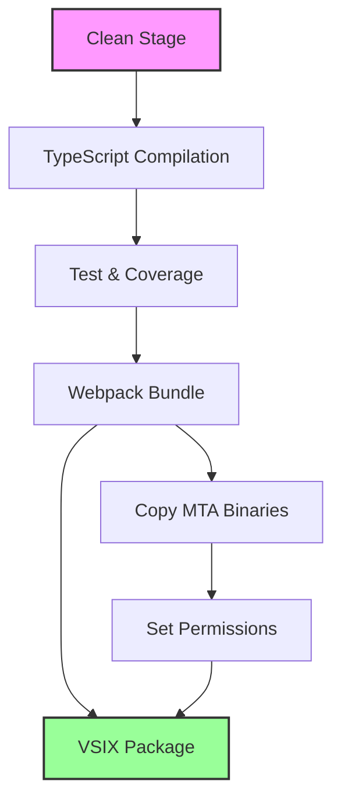
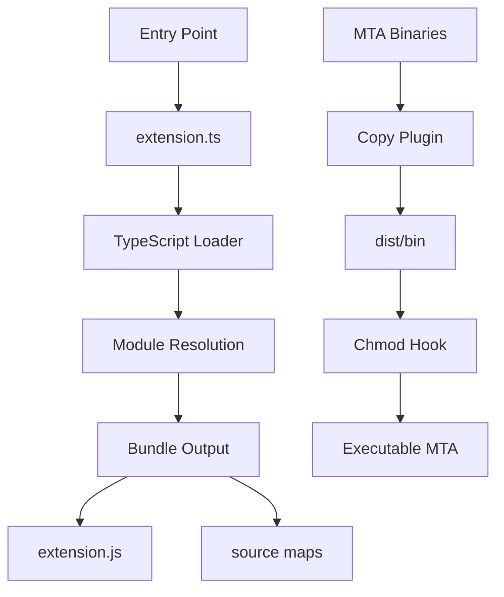
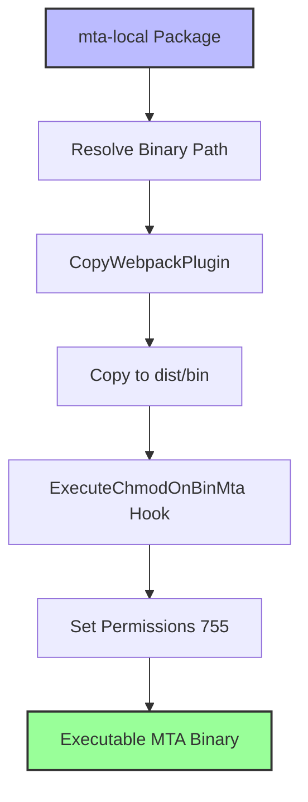
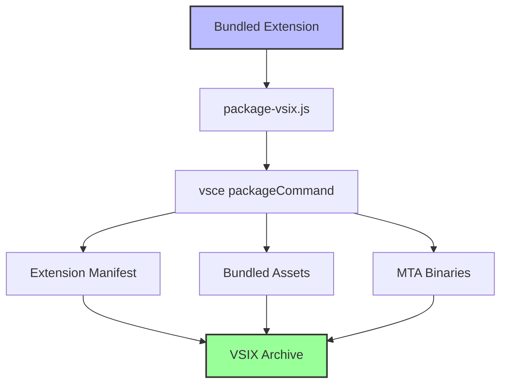
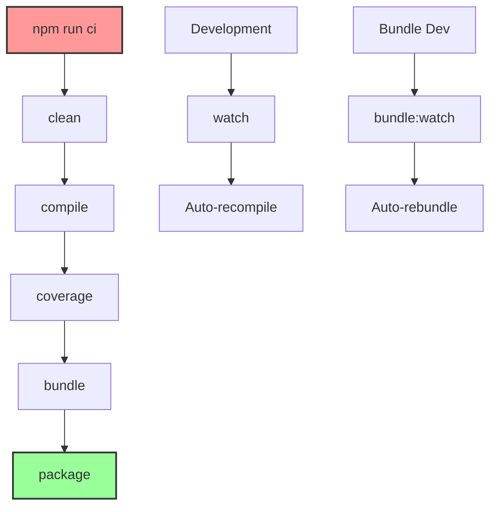

# Build & Packaging Pipeline - Overview & Architecture

The vscode-mta-tools extension implements a comprehensive build and packaging pipeline for SAP Multi-Target Application (MTA) projects within Visual Studio Code. This pipeline orchestrates the compilation of TypeScript source code, bundling of extension assets, integration of external MTA build tools, and final packaging into a distributable VSIX format. The pipeline leverages Webpack for module bundling, TypeScript compilation, and specialized plugins to ensure the cloud-mta tooling is properly integrated and executable across different platforms. The entire process is automated through npm scripts that coordinate cleaning, compilation, testing, bundling, and packaging phases to produce a production-ready VS Code extension.

Sources: [webpack.config.js:1-67](../../../webpack.config.js#L1-L67), [package.json:1-186](../../../package.json#L1-L186)

## Build Pipeline Architecture

The build pipeline follows a multi-stage architecture that transforms TypeScript source code into a bundled, optimized extension package. The pipeline consists of five primary stages: cleaning, compilation, testing with coverage, webpack bundling, and VSIX packaging.



The pipeline is orchestrated through npm scripts defined in package.json, with the main CI script executing: `npm-run-all clean compile coverage bundle package`. This ensures each stage completes successfully before proceeding to the next.

Sources: [package.json:77-84](../../../package.json#L77-L84)

## TypeScript Compilation Configuration

The TypeScript compilation stage transforms source files from the `src` and `tests` directories into JavaScript output in the `dist` folder. The compilation is configured to enforce strict type checking and return value requirements.

### Compiler Options

| Option            | Value    | Purpose                                                    |
| ----------------- | -------- | ---------------------------------------------------------- |
| rootDir           | `.`      | Sets the root directory for source files                   |
| outDir            | `./dist` | Specifies output directory for compiled JavaScript         |
| noImplicitReturns | `true`   | Enforces explicit return statements in functions           |
| skipLibCheck      | `true`   | Skips type checking of declaration files for faster builds |

The configuration extends a base TypeScript configuration (`tsconfig.base.json`) to maintain consistency across the monorepo structure.

Sources: [tsconfig.json:1-10](../../../tsconfig.json#L1-L10)

## Webpack Bundling Strategy

The webpack configuration implements a Node.js-targeted bundling strategy optimized for VS Code extension execution. The bundler consolidates all TypeScript modules into a single `extension.js` file while handling external dependencies and binary assets.



### Bundle Configuration Details

The webpack configuration specifies critical settings for extension bundling:

- **Target**: `node` - Ensures compatibility with VS Code's Node.js runtime environment
- **Entry**: `./src/extension.ts` - The main extension activation point
- **Output**: `dist/extension.js` with `commonjs2` library target for Node.js module compatibility
- **Externals**: The `vscode` module is excluded from bundling as it's provided by the VS Code runtime
- **DevTool**: `source-map` generation for debugging support

Sources: [webpack.config.js:9-30](../../../webpack.config.js#L9-L30)

### Module Processing Rules

The webpack pipeline processes TypeScript files through ts-loader, excluding node_modules to optimize build performance:

```javascript
{
  test: /\.ts$/,
  exclude: /node_modules/,
  use: [
    {
      loader: "ts-loader",
    },
  ],
}
```

File extensions are resolved in the order: `.ts`, `.js`, allowing seamless imports without explicit extensions.

Sources: [webpack.config.js:35-46](../../../webpack.config.js#L35-L46), [webpack.config.js:31-34](../../../webpack.config.js#L31-L34)

## MTA Binary Integration

A critical aspect of the build pipeline is the integration of the cloud-mta command-line tool. The pipeline ensures that MTA binaries are properly copied and configured for runtime execution.



### Binary Copy Process

The CopyWebpackPlugin is configured to locate the MTA binary from the `mta-local` npm package and copy it to the distribution folder:

```javascript
new CopyWebpackPlugin({
  patterns: [
    {
      from: path.join(require.resolve("mta-local"), "..", "bin"),
      to: path.resolve(distPath, "bin"),
    },
  ],
});
```

This approach enables the cloud-mta auto-download functionality as documented in the cloud-mta webpack packaging guidelines.

Sources: [webpack.config.js:48-59](../../../webpack.config.js#L48-L59)

### Executable Permission Configuration

A custom webpack plugin hook ensures the MTA binary has executable permissions on Unix-based systems:

```javascript
function (compiler) {
  compiler.hooks.done.tap("ExecuteChmodOnBinMta", () => {
    fs.chmodSync(path.resolve(distPath, "bin", "mta"), "755");
  });
}
```

The hook executes after webpack completes bundling, setting file permissions to `755` (owner: read/write/execute, group/others: read/execute).

Sources: [webpack.config.js:60-64](../../../webpack.config.js#L60-L64)

### Node.js Directory Handling

The webpack configuration disables the `__dirname` transformation to preserve the actual directory path at runtime:

```javascript
node: {
  __dirname: false,
}
```

This setting is essential for the cloud-mta tool to correctly locate its binary files relative to the extension's installation directory.

Sources: [webpack.config.js:47-50](../../../webpack.config.js#L47-L50)

## Testing and Coverage Pipeline

The pipeline incorporates comprehensive testing with code coverage requirements enforced through NYC (Istanbul). The testing stage must complete successfully before proceeding to bundling.

### Coverage Thresholds

| Metric     | Threshold | Scope              |
| ---------- | --------- | ------------------ |
| Branches   | 90%       | All included files |
| Lines      | 95%       | All included files |
| Functions  | 90%       | All included files |
| Statements | 95%       | All included files |

The coverage configuration includes all files in `dist/src/**` while explicitly excluding logger implementations from coverage requirements. Coverage reports are generated in both text and LCOV formats for CI/CD integration.

Sources: [nyc.config.js:1-13](../../../nyc.config.js#L1-L13)

### Test Execution Scripts

The pipeline provides multiple test execution modes:

- **test**: Executes mocha test suite without coverage
- **coverage**: Runs tests with NYC instrumentation and coverage reporting
- **ci**: Full pipeline including coverage as a gating step

Sources: [package.json:80-81](../../../package.json#L80-L81)

## VSIX Packaging Process

The final stage of the pipeline produces a distributable VSIX (Visual Studio Code Extension) package using the vsce (Visual Studio Code Extension) tooling.



### Packaging Script Configuration

The packaging script invokes vsce with specific configuration options:

```javascript
packageCommand({
  cwd: rootExtDir,
  packagePath: undefined,
  baseContentUrl: undefined,
  baseImagesUrl: undefined,
  useYarn: true,
  ignoreFile: undefined,
  expandGitHubIssueLinks: undefined,
});
```

The `useYarn: true` option matches the repository's package management convention. Since the extension is fully webpack-bundled, all dependencies are already included in the distribution, making this a safe configuration choice.

Sources: [scripts/package-vsix.js:1-17](../../../scripts/package-vsix.js#L1-L17)

### Extension Entry Point

The packaged extension specifies its entry point through the package.json manifest:

```json
"main": "./dist/extension.js"
```

This points to the webpack-generated bundle that contains all extension code and dependencies.

Sources: [package.json:32](../../../package.json#L32)

## Build Script Orchestration

The build pipeline is orchestrated through a series of npm scripts that can be executed individually or as part of the complete CI pipeline.

### Script Execution Flow



### Script Definitions

| Script       | Command                                             | Purpose                                |
| ------------ | --------------------------------------------------- | -------------------------------------- |
| ci           | `npm-run-all clean compile coverage bundle package` | Full CI/CD pipeline execution          |
| clean        | `rimraf ./out ./dist *.vsix ./.nyc_output`          | Removes all build artifacts            |
| compile      | `tsc -p ./`                                         | TypeScript compilation                 |
| watch        | `tsc -watch -p ./`                                  | Continuous TypeScript compilation      |
| test         | `mocha`                                             | Test execution without coverage        |
| coverage     | `nyc mocha`                                         | Test execution with coverage reporting |
| bundle       | `webpack --mode production`                         | Production webpack bundling            |
| bundle:watch | `webpack --mode development --watch`                | Development bundling with watch mode   |
| package      | `node ./scripts/package-vsix.js`                    | VSIX package creation                  |

The `npm-run-all` utility ensures sequential execution of pipeline stages, failing fast if any stage encounters errors.

Sources: [package.json:77-84](../../../package.json#L77-L84)

## Build Artifacts and Output Structure

The build pipeline produces a structured output in the `dist` directory:

```
dist/
├── extension.js          # Bundled extension code
├── extension.js.map      # Source map for debugging
├── bin/
│   └── mta              # MTA CLI binary (executable)
└── src/                 # Compiled TypeScript (for coverage)
```

The clean script ensures all previous artifacts are removed before each build, including:

- `./out` - TypeScript compilation output
- `./dist` - Webpack bundle output
- `*.vsix` - Previous extension packages
- `./.nyc_output` - Coverage instrumentation data

Sources: [package.json:78](../../../package.json#L78), [webpack.config.js:13-18](../../../webpack.config.js#L13-L18)

## Dependencies and Build Tools

The build pipeline relies on several key development dependencies:

| Tool                | Version       | Purpose                               |
| ------------------- | ------------- | ------------------------------------- |
| webpack             | (via config)  | Module bundling and asset management  |
| ts-loader           | 8.0.16        | TypeScript compilation within webpack |
| copy-webpack-plugin | 9.0.1         | Binary asset copying                  |
| nyc                 | (via config)  | Code coverage instrumentation         |
| vsce                | (via scripts) | VSIX package creation                 |
| rimraf              | ^3.0.0        | Cross-platform file/directory removal |

The extension also includes runtime dependencies that are bundled into the final package, including `@sap/mta-lib` for MTA project manipulation and `@sap/cf-tools` for Cloud Foundry integration.

Sources: [package.json:95-105](../../../package.json#L95-L105), [package.json:86-94](../../../package.json#L86-L94)

## Summary

The vscode-mta-tools build and packaging pipeline represents a sophisticated multi-stage process that transforms TypeScript source code into a production-ready VS Code extension. The pipeline ensures code quality through comprehensive testing and coverage requirements, optimizes the extension bundle through webpack, integrates platform-specific MTA binaries with proper permissions, and packages everything into a distributable VSIX format. This automated pipeline enables consistent, repeatable builds suitable for CI/CD environments while maintaining the flexibility for local development through watch modes and incremental compilation. The architecture's emphasis on webpack bundling and binary integration ensures the extension can function independently with all necessary tools embedded within the package.
