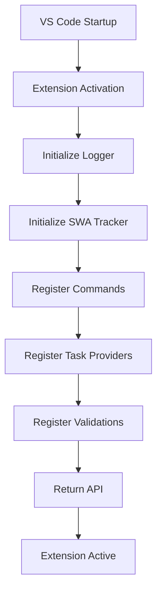
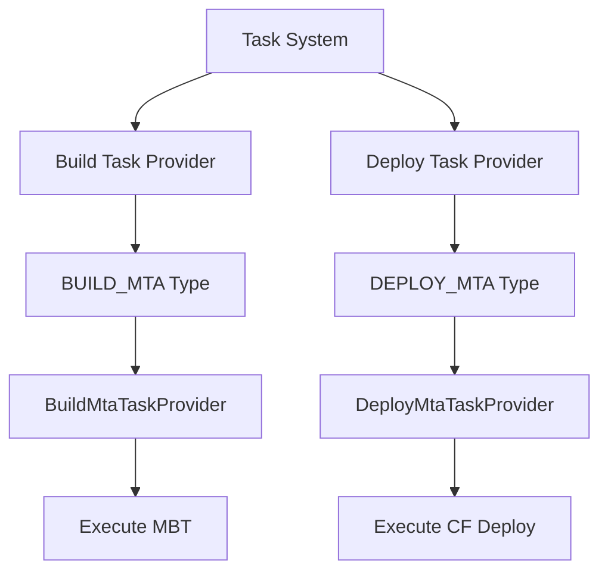
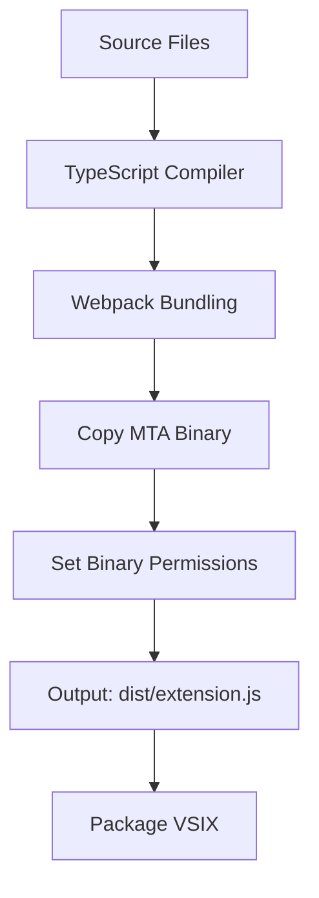

# Extension Overview & Activation

The `vscode-mta-tools` extension is a Visual Studio Code extension designed to facilitate the development, building, and deployment of SAP Multi-Target Application (MTA) projects. This extension provides developers with integrated tooling for managing MTA projects directly within VS Code, including task providers for building and deploying MTAs, validation support for MTA descriptors, and commands for module creation. The extension activates immediately upon VS Code startup and registers various commands, task providers, and validation mechanisms that enable seamless MTA development workflows.

This page provides a comprehensive overview of the extension's architecture, activation lifecycle, core components, and configuration. It details how the extension initializes, what capabilities it exposes, and how different components integrate to provide a cohesive development experience for MTA projects.

Sources: [src/extension.ts:1-96](../../../src/extension.ts#L1-L96), [package.json:1-30](../../../package.json#L1-L30)

## Extension Metadata and Configuration

The extension is published by SAPSE under the Apache-2.0 license and requires VS Code version 1.53.0 or higher. It is part of the SAP App Studio Toolkit monorepo and depends on the `sapos.yeoman-ui` extension for template-based module generation capabilities.

| Property          | Value               | Description                   |
| ----------------- | ------------------- | ----------------------------- |
| Name              | vscode-mta-tools    | Internal extension identifier |
| Display Name      | vscode-mta-tools    | User-facing extension name    |
| Version           | 1.4.11              | Current extension version     |
| Publisher         | SAPSE               | SAP SE publisher identifier   |
| Minimum VS Code   | ^1.53.0             | Required VS Code version      |
| Activation Events | \*                  | Activates on VS Code startup  |
| Main Entry Point  | ./dist/extension.js | Bundled extension entry file  |

Sources: [package.json:2-27](../../../package.json#L2-L27)

## Activation Lifecycle

The extension uses an immediate activation strategy, indicated by the `"*"` activation event in `package.json`, meaning it activates as soon as VS Code starts. The activation process is orchestrated by the `activate` function, which serves as the extension's entry point and returns a Task Editor Contributor API.



Sources: [package.json:23-25](../../../package.json#L23-L25), [src/extension.ts:20-62](../../../src/extension.ts#L20-L62)

### Activation Sequence

The activation function executes the following initialization steps in order:

1. **Logger Initialization**: Configures the extension logger and subscribes to log settings changes
2. **Analytics Setup**: Initializes the SAP Web Analytics (SWA) tracker for telemetry
3. **Command Registration**: Registers three main commands for building, deploying, and adding modules
4. **Task Provider Registration**: Registers two task providers for build and deploy operations
5. **Validation Registration**: Sets up YAML validation for MTA descriptor files
6. **API Export**: Returns the Task Editor Contributor API for integration with other extensions

```typescript
export async function activate(
  context: ExtensionContext
): Promise<TaskEditorContributorExtensionAPI<ConfiguredTask>> {
  initializeLogger(context);
  const logger = getLogger();
  const swa = new SWATracker(
    "SAPSE",
    "vscode-mta-tools",
    /* istanbul ignore next */
    (err: string | number) => {
      if (err !== 204) {
        logger.error(err.toString());
      }
    }
  );

  initSWA(swa);
  // ... registration code
  return {
    getTaskEditorContributors() {
      const contributors = new Map<
        string,
        TaskEditorContributionAPI<ConfiguredTask>
      >();
      return contributors;
    },
  };
}
```

Sources: [src/extension.ts:20-62](../../../src/extension.ts#L20-L62)

## Core Components

### Command Registration

The extension registers three primary commands that provide user-facing functionality for MTA project operations. These commands are accessible through the command palette and context menus.

| Command ID                  | Title                           | Description                         | Context Menu Trigger    |
| --------------------------- | ------------------------------- | ----------------------------------- | ----------------------- |
| extension.mtaBuildCommand   | Build MTA Project               | Builds an MTA project from mta.yaml | Right-click on mta.yaml |
| extension.mtarDeployCommand | Deploy MTA Archive              | Deploys a built MTAR file           | N/A                     |
| extension.addModuleCommand  | Create MTA Module from Template | Adds a new module to an MTA project | Right-click on mta.yaml |

The commands are registered in the activation function and delegated to dedicated command classes:

```typescript
context.subscriptions.push(
  commands.registerCommand("extension.mtaBuildCommand", mtaBuildCommand)
);
context.subscriptions.push(
  commands.registerCommand("extension.mtarDeployCommand", mtarDeployCommand)
);
context.subscriptions.push(
  commands.registerCommand("extension.addModuleCommand", addModuleCommand)
);
```

Sources: [src/extension.ts:36-44](../../../src/extension.ts#L36-L44), [package.json:97-109](../../../package.json#L97-L109), [package.json:110-123](../../../package.json#L110-L123)

### Task Providers

The extension implements two task providers that enable users to define and execute MTA-specific tasks within VS Code's task system. These providers support both auto-detection and manual task configuration.



#### Build MTA Task Provider

Registered for the `build-mta` task type, this provider enables building MTA projects using the Cloud MTA Build Tool (MBT). It supports building entire projects or specific modules with dependencies.

```typescript
const buildTaskProvider = new BuildMtaTaskProvider(context);
context.subscriptions.push(
  tasks.registerTaskProvider(BUILD_MTA, buildTaskProvider)
);
```

Sources: [src/extension.ts:49-51](../../../src/extension.ts#L49-L51), [src/task-providers/definitions.ts](../../../src/task-providers/definitions.ts)

#### Deploy MTA Task Provider

Registered for the `deploy-mta` task type, this provider handles deployment of MTAR archives to Cloud Foundry using the MultiApps CF CLI plugin.

```typescript
const deployTaskProvider = new DeployMtaTaskProvider(context);
context.subscriptions.push(
  tasks.registerTaskProvider(DEPLOY_MTA, deployTaskProvider)
);
```

Sources: [src/extension.ts:46-48](../../../src/extension.ts#L46-L48)

## Task Definitions

The extension contributes two task definition schemas that define the structure and required parameters for MTA build and deploy tasks.

### Build MTA Task Definition

| Property         | Type   | Required | Description                 |
| ---------------- | ------ | -------- | --------------------------- |
| label            | string | Yes      | Task name                   |
| taskType         | string | Yes      | Task type identifier        |
| buildType        | string | Yes      | Build type (project/module) |
| mtaFilePath      | string | Yes      | Path to mta.yaml file       |
| mtarTargetPath   | string | No       | Path to MTAR target folder  |
| mtarName         | string | No       | MTAR file name              |
| extPath          | string | No       | Path to extension file      |
| modules          | array  | No       | Modules to build            |
| dependencies     | array  | No       | Module dependencies         |
| targetFolderPath | string | No       | Path to target folder       |

Sources: [package.json:39-82](../../../package.json#L39-L82)

### Deploy MTA Task Definition

| Property | Type   | Required | Description            |
| -------- | ------ | -------- | ---------------------- |
| label    | string | Yes      | Task name              |
| taskType | string | Yes      | Task type identifier   |
| mtarPath | string | Yes      | Path to the MTAR file  |
| extPath  | string | No       | Path to extension file |

Sources: [package.json:28-50](../../../package.json#L28-L50)

## Validation and Schema Support

The extension provides JSON schema validation for MTA descriptor files, enabling IntelliSense and error detection for MTA-related YAML files. Validation is registered during extension activation and leverages external schema definitions.

### Supported File Types

| File Pattern        | Schema URL                          | Description                |
| ------------------- | ----------------------------------- | -------------------------- |
| mta.yaml, mta.yml   | https://json.schemastore.org/mta    | MTA development descriptor |
| mtad.yaml, mtad.yml | https://json.schemastore.org/mtad   | MTA deployment descriptor  |
| \*.mtaext           | https://json.schemastore.org/mtaext | MTA extension descriptor   |

The extension also associates the `.mtaext` extension with the YAML language for proper syntax highlighting:

```json
"languages": [
  {
    "id": "yaml",
    "extensions": [".mtaext"]
  }
]
```

Sources: [package.json:88-107](../../../package.json#L88-L107), [package.json:83-87](../../../package.json#L83-L87), [src/extension.ts:53](../../../src/extension.ts#L53)

## Logging and Diagnostics

### Logger Configuration

The extension implements a configurable logging system that supports multiple log levels and optional source location tracking. Logger initialization occurs early in the activation lifecycle to ensure all subsequent operations can be logged.

```typescript
function initializeLogger(context: ExtensionContext): void {
  try {
    createExtensionLoggerAndSubscribeToLogSettingsChanges(context);
  } catch (error) {
    console.error(messages.ERROR_ACTIVATION_FAILED, error.message);
  }
}
```

Sources: [src/extension.ts:87-93](../../../src/extension.ts#L87-L93)

### Configuration Options

| Setting                          | Type    | Default | Description                                                       |
| -------------------------------- | ------- | ------- | ----------------------------------------------------------------- |
| MTA Tools.loggingLevel           | enum    | error   | Verbosity level: off, fatal, error, warn, info, debug, trace      |
| MTA Tools.sourceLocationTracking | boolean | false   | Adds source code location to log entries (may impact performance) |

Sources: [package.json:125-147](../../../package.json#L125-L147)

### Problem Matchers

The extension contributes a problem matcher for MTA validation that integrates with VS Code's Problems panel:

```json
"problemMatchers": [
  {
    "name": "MTA",
    "source": "MTA Validate",
    "label": "Validate MTA development descriptor and extension files"
  }
]
```

Sources: [package.json:84-90](../../../package.json#L84-L90)

## Analytics and Telemetry

The extension integrates SAP Web Analytics (SWA) for usage tracking and telemetry. The SWA tracker is initialized during activation and configured to log errors that occur during telemetry transmission.

```typescript
const swa = new SWATracker(
  "SAPSE",
  "vscode-mta-tools",
  /* istanbul ignore next */
  (err: string | number) => {
    if (err !== 204) {
      logger.error(err.toString());
    }
  }
);

initSWA(swa);
```

The tracker monitors user interactions with MTA commands and task operations, sending events for:

- MTA module addition
- MTA project builds
- MTAR deployments
- Task configuration saves

Sources: [src/extension.ts:26-35](../../../src/extension.ts#L26-L35), [src/i18n/messages.ts:24-27](../../../src/i18n/messages.ts#L24-L27)

## Build and Bundling

The extension uses Webpack for bundling and includes special handling for the Cloud MTA Build Tool binary. The build configuration ensures that the extension is properly packaged with all necessary dependencies.



### Webpack Configuration

The webpack configuration targets Node.js, bundles TypeScript files, and includes custom plugins for MTA binary handling:

1. **Entry Point**: `src/extension.ts`
2. **Output**: `dist/extension.js` with CommonJS2 library target
3. **Externals**: VS Code API excluded from bundle
4. **Plugins**:
   - CopyWebpackPlugin: Copies MTA binary to dist/bin
   - Custom chmod plugin: Sets executable permissions on MTA binary

Sources: [webpack.config.js:1-67](../../../webpack.config.js#L1-L67), [package.json:149-158](../../../package.json#L149-L158)

## Dependencies

### Runtime Dependencies

| Package                 | Version      | Purpose                                 |
| ----------------------- | ------------ | --------------------------------------- |
| @sap/mta-lib            | 1.7.4        | MTA descriptor parsing and manipulation |
| @sap/cf-tools           | 3.3.1        | Cloud Foundry integration               |
| @sap/swa-for-sapbas-vsx | 1.2.15       | Analytics and telemetry                 |
| @vscode-logging/logger  | workspace:\* | Logging infrastructure                  |
| fs-extra                | 11.3.0       | Enhanced file system operations         |
| lodash                  | 4.17.21      | Utility functions                       |
| comment-json            | 4.1.1        | JSON with comments support              |
| datauri                 | 2.0.0        | Data URI encoding                       |

### Development Dependencies

The extension requires `@sap_oss/task_contrib_types` for task editor contribution type definitions, enabling integration with SAP's task configuration UI.

Sources: [package.json:160-169](../../../package.json#L160-L169), [package.json:170-182](../../../package.json#L170-L182)

## Extension API

The extension exports a Task Editor Contributor API that allows other extensions to integrate with its task configuration capabilities. Currently, the API returns an empty contributors map, indicating that the extension provides task definitions but does not expose custom task editor UI components.

```typescript
return {
  /* istanbul ignore next */
  getTaskEditorContributors() {
    const contributors = new Map<
      string,
      TaskEditorContributionAPI<ConfiguredTask>
    >();
    return contributors;
  },
};
```

This API structure allows for future extensibility where custom task editors could be registered and exposed to consuming extensions.

Sources: [src/extension.ts:55-62](../../../src/extension.ts#L55-L62), [src/extension.ts:1-19](../../../src/extension.ts#L1-L19)

## Summary

The `vscode-mta-tools` extension provides a comprehensive development environment for SAP Multi-Target Applications within VS Code. It activates immediately on startup, initializes logging and analytics infrastructure, and registers commands, task providers, and validation support for MTA development workflows. The extension's architecture separates concerns through dedicated command classes and task providers, while maintaining a clean activation lifecycle that ensures all components are properly initialized before use. With support for both build and deployment operations, schema validation, and extensible task configuration, the extension serves as a complete toolkit for MTA project development.

Sources: [src/extension.ts](../../../src/extension.ts), [package.json](../../../package.json), [webpack.config.js](../../../webpack.config.js), [src/i18n/messages.ts](../../../src/i18n/messages.ts), [tsconfig.json](../../../tsconfig.json)
