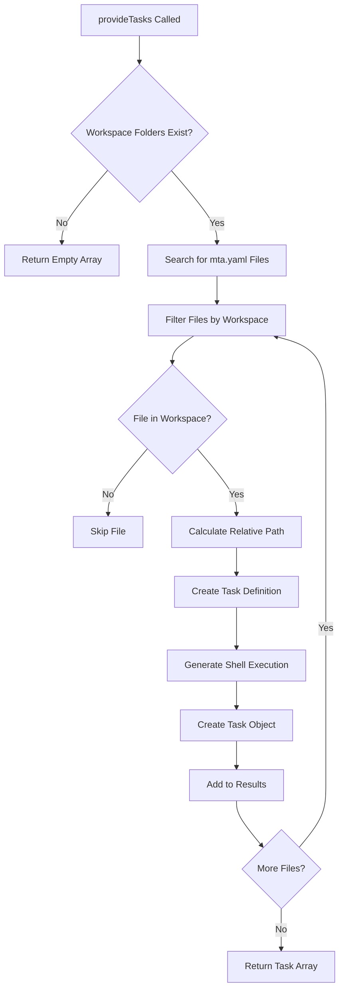
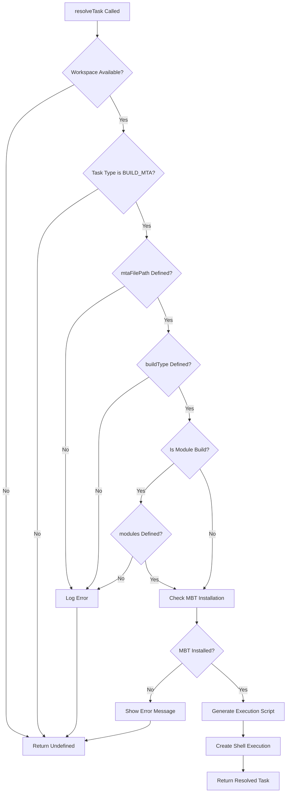
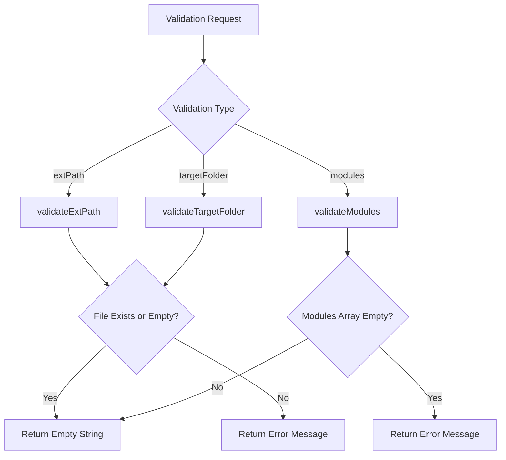
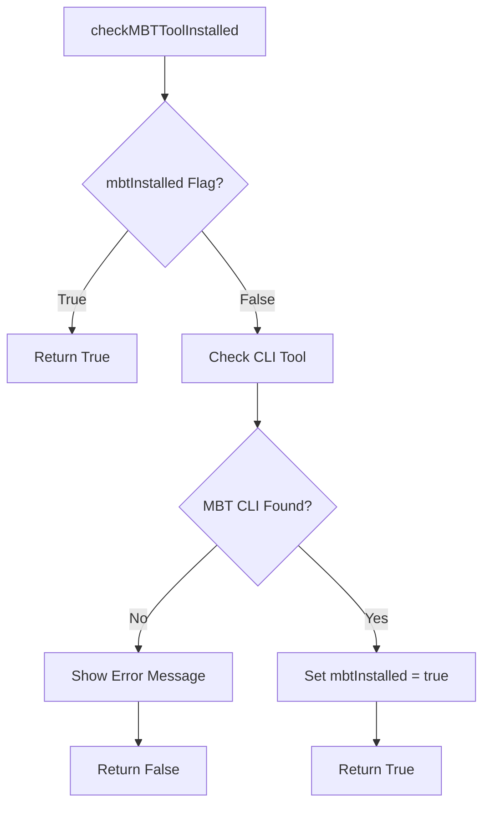
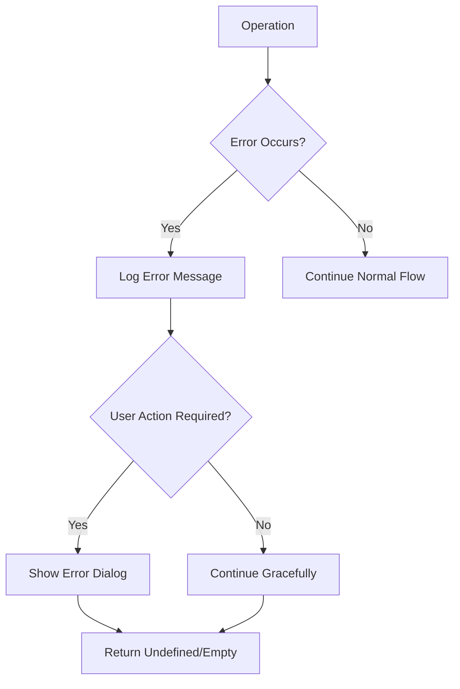

# Build Task Provider

## Introduction

The Build Task Provider is a core component of the vscode-mta-tools extension that enables developers to build SAP Multi-Target Application (MTA) projects directly from Visual Studio Code. This provider implements the VS Code `TaskProvider` interface to automatically discover MTA projects in the workspace and create build tasks for them. It supports two primary build modes: building entire MTA projects into deployable archives (MTAR files) and building individual MTA modules with their dependencies. The provider leverages the MBT (Multi-Target Build Tool) command-line interface to execute builds and provides comprehensive task configuration options including custom target paths, extension descriptors, and module-specific build parameters.

Sources: [buildTask.ts:1-220](../../../src/task-providers/task-build/buildTask.ts#L1-L220), [definitions.ts:1-32](../../../src/task-providers/definitions.ts#L1-L32)

## Architecture Overview

The Build Task Provider follows VS Code's task provider pattern, implementing both task discovery (`provideTasks`) and task resolution (`resolveTask`) methods. The architecture consists of three main components:

```mermaid
graph TD
    A[BuildMtaTaskProvider] --> B[Task Discovery]
    A --> C[Task Resolution]
    A --> D[MBT Tool Validation]
    B --> E[Workspace Scanner]
    E --> F[MTA Files Detector]
    C --> G[Script Generator]
    G --> H[Project Build Script]
    G --> I[Module Build Script]
    D --> J[CLI Tool Checker]
```



The `BuildMtaTaskProvider` class serves as the main entry point, coordinating between task discovery, resolution, and validation subsystems. The provider automatically scans workspace folders for `mta.yaml` files and generates corresponding build tasks with appropriate shell execution scripts.

Sources: [buildTask.ts:25-115](../../../src/task-providers/task-build/buildTask.ts#L25-L115)

## Core Components

### BuildMtaTaskProvider Class

The `BuildMtaTaskProvider` class implements the VS Code `TaskProvider` interface and manages the lifecycle of MTA build tasks.

| Component                 | Type             | Description                                                 |
| ------------------------- | ---------------- | ----------------------------------------------------------- |
| `mbtInstalled`            | boolean          | Cached flag indicating MBT CLI installation status          |
| `context`                 | ExtensionContext | VS Code extension context for accessing extension resources |
| `provideTasks()`          | Method           | Discovers and returns all available MTA build tasks         |
| `resolveTask()`           | Method           | Resolves and validates user-defined build tasks             |
| `checkMBTToolInstalled()` | Method           | Validates MBT CLI installation and caches result            |

Sources: [buildTask.ts:25-115](../../../src/task-providers/task-build/buildTask.ts#L25-L115)

### Task Definition Types

The provider uses strongly-typed task definitions to ensure configuration validity:

```typescript
export interface BuildTaskDefinitionType extends ConfiguredTask {
  taskType: string;
  mtaFilePath: string;
  buildType: BuildTypeOptions;
  mtarTargetPath?: string;
  mtarName?: string;
  extPath?: string;
  modules?: string[];
  dependencies?: string[];
  targetFolderPath?: string;
}
```

Sources: [definitions.ts:14-26](../../../src/task-providers/definitions.ts#L14-L26)

## Task Discovery Flow

The task discovery process automatically identifies MTA projects and generates build tasks:



The discovery process follows these steps:

1. **Workspace Validation**: Checks if workspace folders are available
2. **File Discovery**: Searches for `mta.yaml` files using the pattern `**/mta.yaml`, excluding `node_modules`
3. **Path Normalization**: Calculates relative paths for each MTA file within its workspace folder
4. **Task Generation**: Creates task definitions with default build configurations
5. **Execution Script**: Generates MBT command with appropriate parameters

Sources: [buildTask.ts:117-165](../../../src/task-providers/task-build/buildTask.ts#L117-L165), [common.ts:108-120](../../../src/task-providers/utils/common.ts#L108-L120)

## Task Resolution Process

Task resolution validates and configures user-defined tasks from `tasks.json`:



The resolution process performs comprehensive validation:

- **Task Type Validation**: Ensures task type matches `BUILD_MTA` constant
- **Required Properties**: Validates presence of `mtaFilePath` and `buildType`
- **Module Build Validation**: For module builds, ensures `modules` array is defined
- **MBT Installation Check**: Verifies MBT CLI is installed before allowing task execution
- **Script Generation**: Creates appropriate build command based on build type and options

Sources: [buildTask.ts:37-94](../../../src/task-providers/task-build/buildTask.ts#L37-L94)

## Build Types and Execution Scripts

### Project Build (Build MTA Archive)

When building a complete MTA project, the provider generates a command to create a deployable MTAR archive:

```typescript
function getBuildProjectScript(task: Task, projectMtaFilePath: string): string {
  const execScript = `${MBT_COMMAND} build -s "${projectMtaFilePath}"`;
  const mtarTargetPathOpt = task.definition.mtarTargetPath
    ? ` -t "${task.definition.mtarTargetPath}"`
    : "";
  const mtarNameOpt = task.definition.mtarName
    ? ` --mtar "${task.definition.mtarName}"`
    : "";
  const extPathOpt = task.definition.extPath
    ? ` -e "${task.definition.extPath}"`
    : "";
  return `${execScript}${mtarTargetPathOpt}${mtarNameOpt}${extPathOpt}; sleep 2;`;
}
```

**Supported Options:**

| Option           | MBT Flag | Description                                  |
| ---------------- | -------- | -------------------------------------------- |
| `mtarTargetPath` | `-t`     | Target directory for the generated MTAR file |
| `mtarName`       | `--mtar` | Custom name for the MTAR archive             |
| `extPath`        | `-e`     | Path to MTA extension descriptor file        |

Sources: [buildTask.ts:195-210](../../../src/task-providers/task-build/buildTask.ts#L195-L210)

### Module Build

For building individual MTA modules, the provider supports granular control over module selection and dependencies:

```typescript
function getBuildModuleScript(
  task: Task,
  projectMtaFolderPath: string
): string {
  const modulesString = task.definition.modules.join(",");
  const execScript = `${MBT_COMMAND} module-build -m "${modulesString}" -s "${projectMtaFolderPath}" -g`;
  const dependencies = isEmpty(task.definition.dependencies) ? "" : " -a";
  const targetFolderPathOpt = task.definition.targetFolderPath
    ? ` -t "${task.definition.targetFolderPath}"`
    : "";
  const extPathOpt = task.definition.extPath
    ? ` -e "${task.definition.extPath}"`
    : "";
  return `${execScript}${dependencies}${targetFolderPathOpt}${extPathOpt}; sleep 2;`;
}
```

**Supported Options:**

| Option             | MBT Flag | Description                                   |
| ------------------ | -------- | --------------------------------------------- |
| `modules`          | `-m`     | Comma-separated list of module names to build |
| `dependencies`     | `-a`     | Include module dependencies in the build      |
| `targetFolderPath` | `-t`     | Target directory for build artifacts          |
| `extPath`          | `-e`     | Path to MTA extension descriptor file         |

The `-g` flag is always included to generate metadata during module builds.

Sources: [buildTask.ts:212-228](../../../src/task-providers/task-build/buildTask.ts#L212-L228)

## Validation System

The Build Task Provider includes a comprehensive validation system to ensure task configuration correctness:



### Validation Functions

| Function               | Purpose                                 | Error Condition                            |
| ---------------------- | --------------------------------------- | ------------------------------------------ |
| `validateExtPath`      | Validates MTA extension descriptor path | File does not exist at specified path      |
| `validateModules`      | Validates module selection              | Empty modules array                        |
| `validateTargetFolder` | Validates target folder path            | Directory does not exist at specified path |

All validators return an empty string on success or an error message on failure. Empty paths are considered valid for optional parameters.

Sources: [buildValidator.ts:1-37](../../../src/task-providers/task-build/buildValidator.ts#L1-L37)

## MBT Tool Installation Check

The provider implements a caching mechanism for MBT CLI installation verification:



The caching strategy prevents repeated CLI checks during a single VS Code session, improving performance. The provider uses the `Utils.isCliToolInstalled` utility to verify the `mbt` command is available in the system PATH.

Sources: [buildTask.ts:96-113](../../../src/task-providers/task-build/buildTask.ts#L96-L113)

## Task Constants and Configuration

The provider uses several constants to maintain consistency across task definitions:

| Constant            | Value                          | Purpose                               |
| ------------------- | ------------------------------ | ------------------------------------- |
| `BUILD_MTA`         | "build-mta"                    | Task type identifier                  |
| `TASK_NAME_PREFIX`  | "Template: Build MTA based on" | Prefix for auto-discovered task names |
| `BUILD_MTA_ARCHIVE` | "Build MTA Project"            | Project-level build identifier        |
| `BUILD_MTA_MODULE`  | "Build MTA Module"             | Module-level build identifier         |
| `MBT_COMMAND`       | "mbt"                          | MBT CLI executable name               |
| `TASK_TYPE_BUILD`   | "Build"                        | Task category type                    |

Sources: [buildTask.ts:17-23](../../../src/task-providers/task-build/buildTask.ts#L17-L23), [definitions.ts:4-9](../../../src/task-providers/definitions.ts#L4-L9)

## Integration with VS Code Task System

The Build Task Provider integrates seamlessly with VS Code's task system through several key mechanisms:

### Task Creation

Tasks are created using the `createTask` utility function, which properly configures task scope, definition, and execution:

```typescript
const task = createTask(
  taskDefinition,
  wsFolder,
  taskName,
  BUILD_MTA,
  taskExecution
);
```

Tasks can be scoped to specific workspace folders or to the entire workspace, ensuring proper context for multi-root workspaces.

Sources: [common.ts:59-73](../../../src/task-providers/utils/common.ts#L59-L73)

### Shell Execution Options

Build tasks use `ShellExecution` with the current working directory set to the MTA project directory:

```typescript
const options: ShellExecutionOptions = {
  cwd: dirname(_task.definition.mtaFilePath),
};
```

This ensures MBT commands execute in the correct project context, allowing relative paths in MTA descriptors to resolve properly.

Sources: [buildTask.ts:72-74](../../../src/task-providers/task-build/buildTask.ts#L72-L74)

## Error Handling and Logging

The provider implements comprehensive error handling throughout the task lifecycle:



**Error Scenarios:**

1. **Missing MTA File Property**: Logs error and returns undefined
2. **Missing Build Type**: Logs error and returns undefined
3. **Missing Modules for Module Build**: Logs error and returns undefined
4. **MBT Not Installed**: Shows error message to user and returns undefined
5. **Workspace Folder Mismatch**: Logs error during task discovery
6. **Task Discovery Failure**: Logs error and returns empty task array

The provider uses the extension's logger wrapper for consistent error reporting and debugging support.

Sources: [buildTask.ts:41-62](../../../src/task-providers/task-build/buildTask.ts#L41-L62), [buildTask.ts:154-156](../../../src/task-providers/task-build/buildTask.ts#L154-L156)

## Testing Coverage

The Build Task Provider includes comprehensive unit tests covering all major functionality:

### Test Categories

| Test Suite     | Coverage Area      | Key Scenarios                                             |
| -------------- | ------------------ | --------------------------------------------------------- |
| `provideTasks` | Task discovery     | Workspace availability, MTA file detection, path matching |
| `resolveTask`  | Task resolution    | Property validation, MBT installation, script generation  |
| Build Scripts  | Command generation | Project builds, module builds, optional parameters        |
| Validators     | Input validation   | Path validation, module validation                        |

The test suite uses Sinon for mocking VS Code APIs and verifies both successful execution paths and error handling scenarios.

Sources: [buildTask.spec.ts:1-274](../../../tests/task-providers/task-build/buildTask.spec.ts#L1-L274), [buildValidator.spec.ts:1-82](../../../tests/task-providers/task-build/buildValidator.spec.ts#L1-L82)

## Summary

The Build Task Provider is a robust component that seamlessly integrates MTA build capabilities into VS Code's task system. It provides automatic task discovery for MTA projects, comprehensive validation of build configurations, and flexible support for both project-level and module-level builds. The provider's caching mechanisms, error handling, and integration with the MBT CLI ensure a reliable and efficient build experience for SAP MTA developers. Through its implementation of VS Code's TaskProvider interface, it enables developers to build MTA projects using standard VS Code task commands while maintaining full configurability through task definitions.
