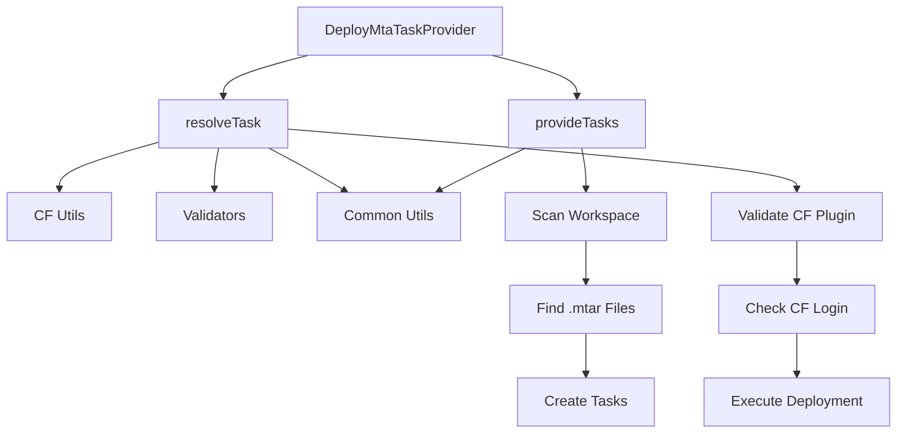
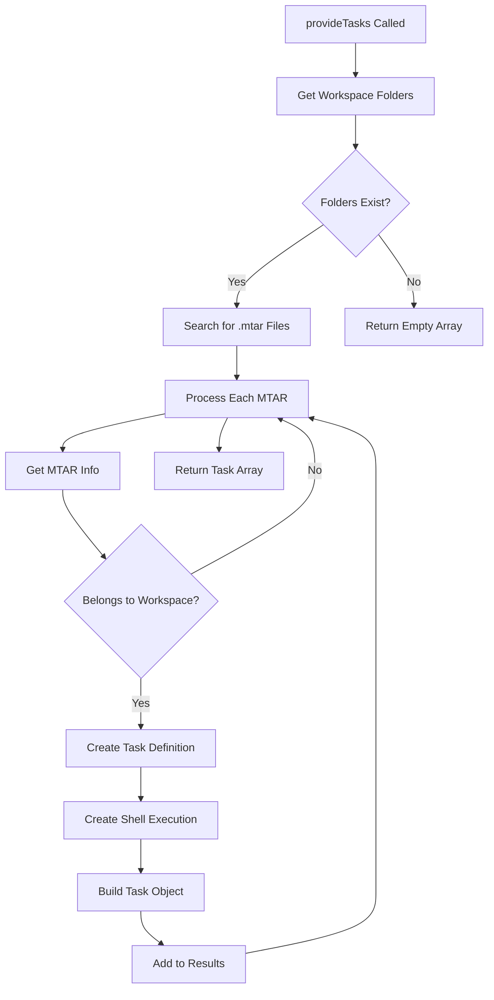
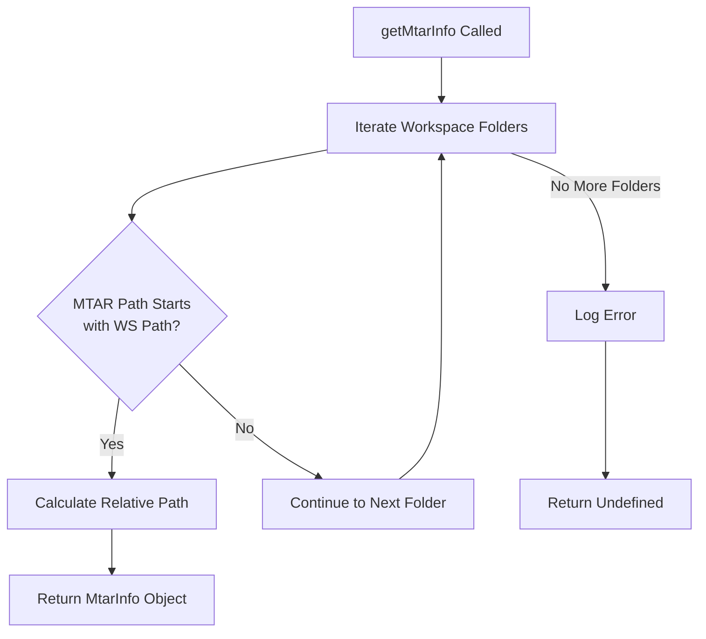
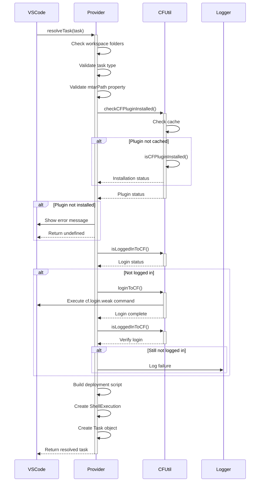
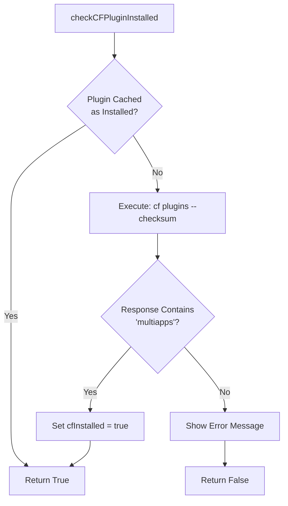
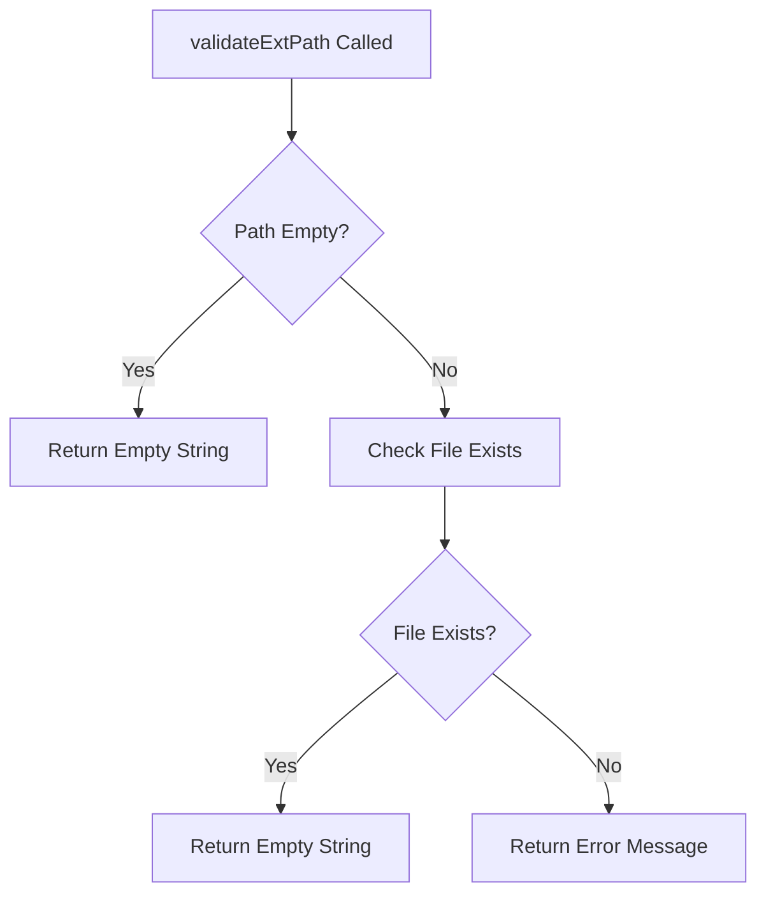

# Deploy Task Provider

The Deploy Task Provider is a core component of the vscode-mta-tools extension that enables automated deployment of SAP Multi-Target Application (MTA) archives to Cloud Foundry environments directly from VS Code. This task provider implements the VS Code `TaskProvider` interface to discover `.mtar` files in the workspace and create deployment tasks that can be executed through the VS Code task system. It handles Cloud Foundry CLI integration, including plugin verification, authentication checks, and deployment command execution with optional MTA extension descriptors.

Sources: [deployTask.ts:1-165](../../../src/task-providers/task-deploy/deployTask.ts#L1-L165)

## Architecture Overview

The Deploy Task Provider follows VS Code's task provider pattern, implementing two primary methods: `provideTasks()` for automatic task discovery and `resolveTask()` for task execution. The provider integrates with the Cloud Foundry CLI to deploy MTAR archives and validates prerequisites before execution.



Sources: [deployTask.ts:18-165](../../../src/task-providers/task-deploy/deployTask.ts#L18-L165), [cfutil.ts:1-39](../../../src/task-providers/utils/cfutil.ts#L1-L39)

## Core Components

### DeployMtaTaskProvider Class

The main class implementing the VS Code `TaskProvider` interface for MTA deployment tasks.

| Property      | Type             | Description                             |
| ------------- | ---------------- | --------------------------------------- |
| `cfInstalled` | boolean          | Cached status of CF plugin installation |
| `context`     | ExtensionContext | VS Code extension context               |

| Method                     | Returns                      | Description                                             |
| -------------------------- | ---------------------------- | ------------------------------------------------------- |
| `provideTasks()`           | `Promise<Task[]>`            | Auto-discovers MTAR files and creates deployment tasks  |
| `resolveTask(task)`        | `Promise<Task \| undefined>` | Resolves and executes a deployment task with validation |
| `checkCFPluginInstalled()` | `Promise<boolean>`           | Verifies CF CLI multiapps plugin installation           |

Sources: [deployTask.ts:18-95](../../../src/task-providers/task-deploy/deployTask.ts#L18-L95)

### Task Definition Type

The `DeployTaskDefinitionType` interface defines the structure of deployment task configurations.

| Field      | Type   | Required | Description                               |
| ---------- | ------ | -------- | ----------------------------------------- |
| `type`     | string | Yes      | Task type identifier (DEPLOY_MTA)         |
| `taskType` | string | Yes      | Display task type ("Deploy")              |
| `label`    | string | Yes      | Task label for UI display                 |
| `mtarPath` | string | Yes      | Absolute path to the MTAR archive         |
| `extPath`  | string | No       | Optional path to MTA extension descriptor |

Sources: [definitions.ts:10-14](../../../src/task-providers/definitions.ts#L10-L14)

## Task Discovery Flow

The `provideTasks()` method automatically discovers MTAR files in the workspace and generates deployment tasks.



The discovery process searches for files matching the pattern `**/*.mtar` and creates tasks with names in the format `Template: Deploy <relative-path>`.

Sources: [deployTask.ts:97-143](../../../src/task-providers/task-deploy/deployTask.ts#L97-L143)

### MTAR Information Resolution

The `getMtarInfo()` function determines the workspace folder ownership of discovered MTAR files.



Sources: [deployTask.ts:145-163](../../../src/task-providers/task-deploy/deployTask.ts#L145-L163)

## Task Resolution and Execution

The `resolveTask()` method validates prerequisites and constructs the deployment command for execution.

### Resolution Sequence



Sources: [deployTask.ts:42-90](../../../src/task-providers/task-deploy/deployTask.ts#L42-L90), [cfutil.ts:13-39](../../../src/task-providers/utils/cfutil.ts#L13-L39)

### Deployment Command Construction

The deployment command is constructed based on the task definition properties:

**Basic Command Structure:**

```bash
cf deploy "<mtarPath>"; sleep 2;
```

**With Extension Descriptor:**

```bash
cf deploy "<mtarPath>" -e "<extPath>"; sleep 2;
```

The command is executed in the user's home directory with a 2-second sleep to ensure output is captured.

Sources: [deployTask.ts:67-74](../../../src/task-providers/task-deploy/deployTask.ts#L67-L74)

## Cloud Foundry Integration

### Plugin Verification

The provider verifies that the Cloud Foundry multiapps plugin is installed before allowing deployments.



Sources: [deployTask.ts:81-93](../../../src/task-providers/task-deploy/deployTask.ts#L81-L93), [cfutil.ts:13-18](../../../src/task-providers/utils/cfutil.ts#L13-L18)

### Authentication Management

The provider checks and manages Cloud Foundry authentication status.

| Function           | Purpose                          | Implementation                                         |
| ------------------ | -------------------------------- | ------------------------------------------------------ |
| `isLoggedInToCF()` | Verifies current CF login status | Checks OrganizationFields and SpaceFields in CF config |
| `loginToCF()`      | Initiates CF login flow          | Executes `cf.login.weak` VS Code command if available  |

The login verification reads the Cloud Foundry configuration file to check for valid organization and space fields.

Sources: [cfutil.ts:20-39](../../../src/task-providers/utils/cfutil.ts#L20-L39)

## Validation

### Extension Descriptor Path Validation

The `validateExtPath()` function validates optional MTA extension descriptor paths.



**Validation Rules:**

- Empty paths are considered valid (extension descriptor is optional)
- Non-empty paths must point to existing files
- Returns empty string for valid paths, error message for invalid paths

Sources: [deployValidator.ts:1-18](../../../src/task-providers/task-deploy/deployValidator.ts#L1-L18)

## Constants and Configuration

| Constant           | Value              | Description                          |
| ------------------ | ------------------ | ------------------------------------ |
| `CF_COMMAND`       | "cf"               | Cloud Foundry CLI command            |
| `DEPLOY_MTA`       | "deploy-mta"       | Task type identifier                 |
| `TASK_NAME_PREFIX` | "Template: Deploy" | Prefix for auto-generated task names |
| `TASK_TYPE_DEPLOY` | "Deploy"           | Display type for deployment tasks    |
| `CF_LOGIN_COMMAND` | "cf.login.weak"    | VS Code command for CF login         |

Sources: [deployTask.ts:15-17](../../../src/task-providers/task-deploy/deployTask.ts#L15-L17), [definitions.ts:3](../../../src/task-providers/definitions.ts#L3), [cfutil.ts:9-10](../../../src/task-providers/utils/cfutil.ts#L9-L10)

## Error Handling

The Deploy Task Provider implements comprehensive error handling:

1. **Missing Workspace:** Returns empty task array or undefined when no workspace folders exist
2. **Missing MTAR Path:** Logs error and returns undefined when task definition lacks mtarPath
3. **CF Plugin Not Installed:** Shows error message and returns undefined
4. **CF Login Failure:** Logs debug message but continues (allows offline task creation)
5. **Auto-Detection Errors:** Catches exceptions during task discovery and logs them

Sources: [deployTask.ts:42-90](../../../src/task-providers/task-deploy/deployTask.ts#L42-L90), [deployTask.ts:127-133](../../../src/task-providers/task-deploy/deployTask.ts#L127-L133)

## Testing Coverage

The Deploy Task Provider includes comprehensive unit tests covering:

- Task discovery with various workspace configurations
- Task resolution with different authentication states
- CF plugin verification scenarios
- Command script generation with required and optional parameters
- Validation of extension descriptor paths
- Error handling for missing dependencies and invalid configurations

Sources: [deployTask.spec.ts:1-187](../../../tests/task-providers/task-deploy/deployTask.spec.ts#L1-L187), [deployValidator.spec.ts:1-40](../../../tests/task-providers/task-deploy/deployValidator.spec.ts#L1-L40)

## Summary

The Deploy Task Provider is a robust implementation that seamlessly integrates MTA deployment capabilities into VS Code's task system. It handles the complete deployment workflow from automatic MTAR discovery to Cloud Foundry authentication and command execution. The provider's design prioritizes user experience through automatic task generation, comprehensive validation, and clear error messaging, while maintaining flexibility through optional extension descriptor support. Its integration with Cloud Foundry CLI and VS Code's extension ecosystem makes it a critical component for SAP MTA development workflows.
