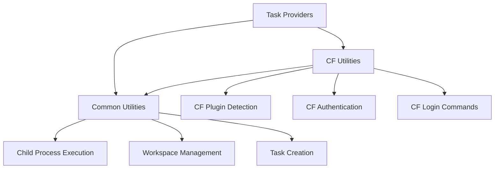
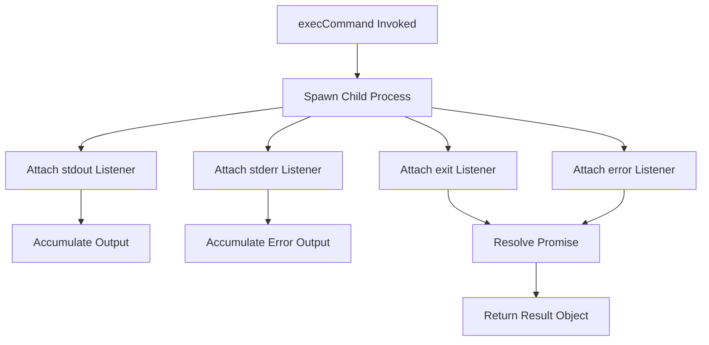
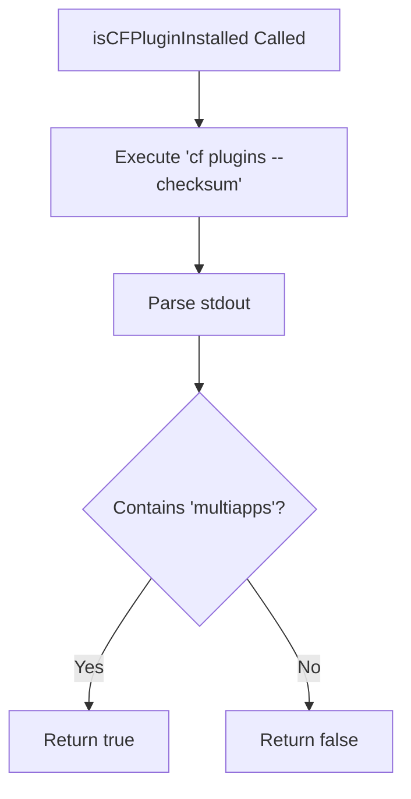
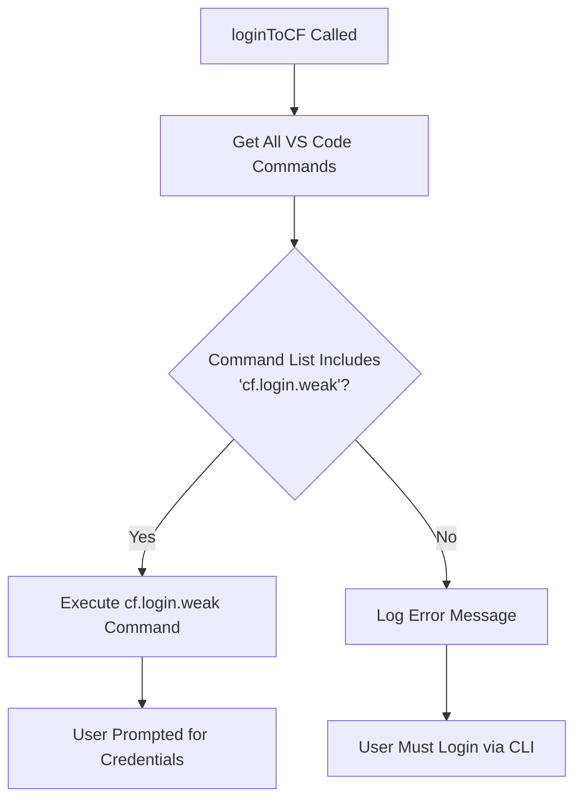
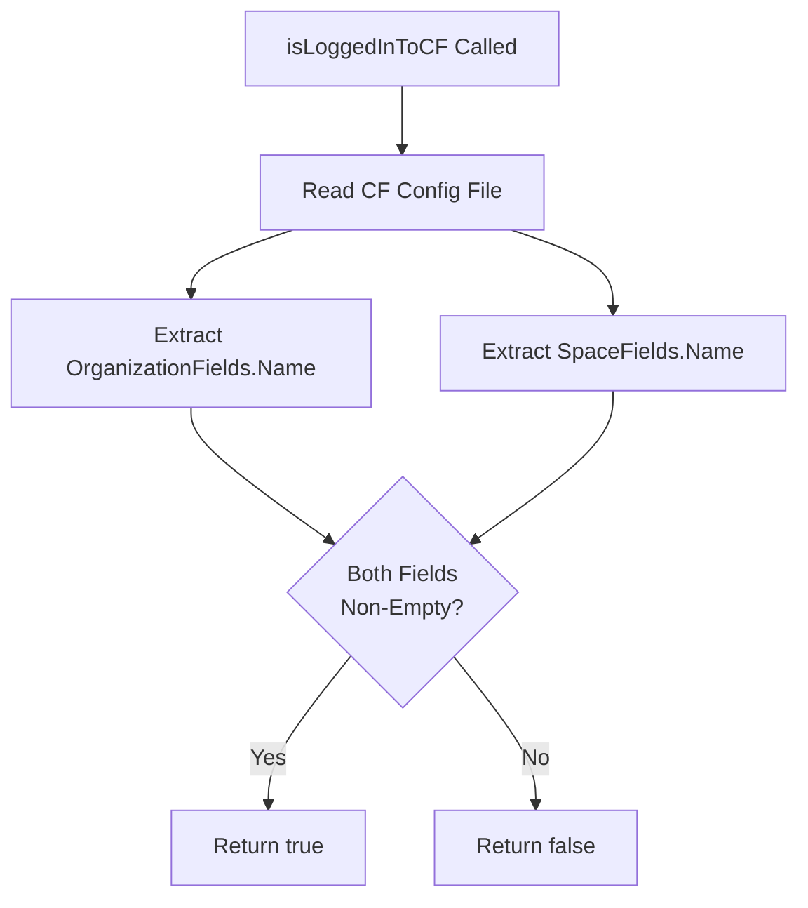
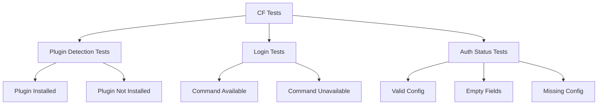

# Task Provider Utilities & CF Integration

This page documents the utility functions and Cloud Foundry (CF) integration components that support the task provider system within the vscode-mta-tools extension. These utilities provide essential functionality for executing system commands, managing workspace resources, and interacting with Cloud Foundry environments. The CF integration specifically enables authentication verification and plugin detection, which are critical for deploying Multi-Target Applications (MTA) to Cloud Foundry platforms.

The utilities are organized into two main modules: `common.ts` for general-purpose task provider utilities, and `cfutil.ts` for Cloud Foundry-specific operations. These modules work together to enable the extension's build and deployment capabilities while maintaining cross-platform compatibility.

Sources: [src/task-providers/utils/common.ts](../../../src/task-providers/utils/common.ts), [src/task-providers/utils/cfutil.ts](../../../src/task-providers/utils/cfutil.ts)

## Architecture Overview

The task provider utilities follow a layered architecture where common utilities provide foundational operations, and CF-specific utilities build upon these to interact with Cloud Foundry environments.



The common utilities module provides low-level operations such as command execution, file path normalization, and workspace folder management. The CF utilities module leverages these operations to perform Cloud Foundry-specific tasks like plugin verification and authentication status checks.

Sources: [src/task-providers/utils/common.ts:1-120](../../../src/task-providers/utils/common.ts#L1-L120), [src/task-providers/utils/cfutil.ts:1-40](../../../src/task-providers/utils/cfutil.ts#L1-L40)

## Common Utilities

### Command Execution

The `execCommand` function provides a promise-based wrapper around Node.js child process spawning, enabling asynchronous command execution with comprehensive output capture.



The function returns a `ChildProcessResult` object containing the exit code, standard output, and standard error streams. This abstraction simplifies command execution throughout the task provider system.

Sources: [src/task-providers/utils/common.ts:29-81](../../../src/task-providers/utils/common.ts#L29-L81)

#### ChildProcessResult Data Structure

| Field      | Type               | Description                                       |
| ---------- | ------------------ | ------------------------------------------------- |
| `exitCode` | `number \| string` | Process exit code (number) or error code (string) |
| `stdout`   | `string`           | Trimmed standard output from the process          |
| `stderr`   | `string`           | Trimmed standard error output from the process    |

Sources: [src/task-providers/utils/common.ts:17-21](../../../src/task-providers/utils/common.ts#L17-L21)

### Platform Detection and File Path Handling

Cross-platform compatibility is achieved through platform detection and path normalization utilities:

```typescript
export function isWindows(): boolean {
  return platform().indexOf("win") > -1;
}

export function getFilePaths(uriPaths: Uri[]): string[] {
  return map(uriPaths, (uri) => {
    return isWindows() ? trimStart(uri.path, "/") : uri.path;
  });
}
```

The `isWindows()` function detects Windows platforms, while `getFilePaths()` normalizes URI paths by removing leading slashes on Windows systems. This ensures consistent file path handling across operating systems.

Sources: [src/task-providers/utils/common.ts:83-92](../../../src/task-providers/utils/common.ts#L83-L92), [src/task-providers/utils/common.ts:94-97](../../../src/task-providers/utils/common.ts#L94-L97)

### Workspace Management

The utilities provide functions for accessing and managing VS Code workspace resources:

| Function                | Return Type                      | Description                                            |
| ----------------------- | -------------------------------- | ------------------------------------------------------ |
| `getWorkspaceFolders()` | `WorkspaceFolder[] \| undefined` | Returns a copy of all workspace folders                |
| `getWSFolderPath()`     | `string`                         | Extracts normalized file path from workspace folder    |
| `getFilesInWorkspace()` | `Promise<string[]>`              | Finds files matching a pattern, excluding node_modules |

These functions abstract VS Code's workspace API and provide platform-aware path handling for workspace resources.

Sources: [src/task-providers/utils/common.ts:106-113](../../../src/task-providers/utils/common.ts#L106-L113), [src/task-providers/utils/common.ts:115-120](../../../src/task-providers/utils/common.ts#L115-L120), [src/task-providers/utils/common.ts:122-135](../../../src/task-providers/utils/common.ts#L122-L135)

### Task Creation

The `createTask` function standardizes VS Code task creation with consistent configuration:

```typescript
export function createTask(
  taskDefinition: TaskDefinition,
  taskScope: WorkspaceFolder | TaskScope | undefined,
  taskName: string,
  taskSource: string,
  execution: ShellExecution
): Task {
  const task = new Task(
    taskDefinition,
    taskScope ?? TaskScope.Workspace,
    taskName,
    taskSource,
    execution
  );
  return task;
}
```

This function ensures all tasks created by the extension follow a uniform structure, defaulting to workspace scope when no specific scope is provided.

Sources: [src/task-providers/utils/common.ts:99-111](../../../src/task-providers/utils/common.ts#L99-L111)

## Cloud Foundry Integration

### CF Plugin Detection

The extension verifies the presence of the MultiApps CF plugin before attempting deployment operations:



The `isCFPluginInstalled()` function executes the CF CLI command to list installed plugins and checks for the presence of "multiapps" in the output. This verification prevents deployment failures due to missing dependencies.

Sources: [src/task-providers/utils/cfutil.ts:12-18](../../../src/task-providers/utils/cfutil.ts#L12-L18)

### Authentication Management

The CF utilities provide two key authentication-related functions:

#### Login Flow



The `loginToCF()` function attempts to trigger the Cloud Foundry login flow through VS Code's command palette. If the `cf.login.weak` command is available (typically provided by a CF extension), it executes it; otherwise, it logs an error instructing users to login via the CLI.

Sources: [src/task-providers/utils/cfutil.ts:20-28](../../../src/task-providers/utils/cfutil.ts#L20-L28)

#### Authentication Status Check



The `isLoggedInToCF()` function verifies authentication status by reading the CF configuration file and checking for populated organization and space fields. This approach avoids making network calls while reliably determining if the user has active CF credentials.

Sources: [src/task-providers/utils/cfutil.ts:30-38](../../../src/task-providers/utils/cfutil.ts#L30-L38)

### CF Utility Constants

| Constant           | Value             | Purpose                             |
| ------------------ | ----------------- | ----------------------------------- |
| `CF_COMMAND`       | `"cf"`            | Base CF CLI command name            |
| `CF_LOGIN_COMMAND` | `"cf.login.weak"` | VS Code command for CF login        |
| `homeDir`          | `homedir()`       | User's home directory for CF config |

These constants centralize CF-related configuration values used throughout the utility module.

Sources: [src/task-providers/utils/cfutil.ts:8-10](../../../src/task-providers/utils/cfutil.ts#L8-L10)

## Task Definition Types

The extension defines structured task definition types to ensure type safety across build and deployment operations:

### Deployment Task Definition

```typescript
export interface DeployTaskDefinitionType extends ConfiguredTask {
  taskType: string;
  mtarPath: string;
  extPath?: string;
}
```

| Field      | Type     | Required | Description                        |
| ---------- | -------- | -------- | ---------------------------------- |
| `taskType` | `string` | Yes      | Task type identifier               |
| `mtarPath` | `string` | Yes      | Path to the MTAR archive to deploy |
| `extPath`  | `string` | No       | Optional extension descriptor path |

Sources: [src/task-providers/definitions.ts:9-13](../../../src/task-providers/definitions.ts#L9-L13)

### Build Task Definition

```typescript
export interface BuildTaskDefinitionType extends ConfiguredTask {
  taskType: string;
  mtaFilePath: string;
  buildType: BuildTypeOptions;
  mtarTargetPath?: string;
  mtarName?: string;
  extPath?: string;
  modules?: string[];
  dependencies?: string[];
  targetFolderPath?: string;
}
```

| Field              | Type               | Required | Description                       |
| ------------------ | ------------------ | -------- | --------------------------------- |
| `taskType`         | `string`           | Yes      | Task type identifier              |
| `mtaFilePath`      | `string`           | Yes      | Path to the MTA descriptor file   |
| `buildType`        | `BuildTypeOptions` | Yes      | Build scope: project or module    |
| `mtarTargetPath`   | `string`           | No       | Target path for generated MTAR    |
| `mtarName`         | `string`           | No       | Custom MTAR archive name          |
| `extPath`          | `string`           | No       | Extension descriptor path         |
| `modules`          | `string[]`         | No       | Specific modules to build         |
| `dependencies`     | `string[]`         | No       | Module dependencies to include    |
| `targetFolderPath` | `string`           | No       | Target folder for build artifacts |

The `BuildTypeOptions` type restricts build types to either "Build MTA Project" or "Build MTA Module", ensuring valid build configurations.

Sources: [src/task-providers/definitions.ts:15-26](../../../src/task-providers/definitions.ts#L15-L26), [src/task-providers/definitions.ts:6-7](../../../src/task-providers/definitions.ts#L6-L7)

## Testing Coverage

The utilities are comprehensively tested to ensure reliability across different scenarios:

### Command Execution Tests

The test suite verifies both successful command execution and error handling:

```typescript
it("resturns expected stdout when command is valid", async () => {
  const response = await common.execCommand("sh", ["-c", "echo test"], {});
  expect(response.stdout).to.include("test");
});

it("resturns exitCode 'ENOENT' when command is not valid", async () => {
  const response = await common.execCommand("bla_123", ["bla_123"], {});
  expect(response.exitCode).to.equal("ENOENT");
});
```

These tests ensure the command execution utility correctly captures output and handles invalid commands with appropriate error codes.

Sources: [tests/task-providers/utils/common.spec.ts:6-15](../../../tests/task-providers/utils/common.spec.ts#L6-L15)

### CF Integration Tests

The CF utility tests cover plugin detection, login flows, and authentication status verification:



Each test scenario validates specific behaviors, such as returning `true` when the multiapps plugin is detected, or `false` when CF configuration fields are empty.

Sources: [tests/task-providers/utils/cfutil.spec.ts:14-70](../../../tests/task-providers/utils/cfutil.spec.ts#L14-L70)

## Summary

The task provider utilities and CF integration form the foundational layer for the vscode-mta-tools extension's build and deployment capabilities. The common utilities provide cross-platform command execution, workspace management, and task creation, while the CF utilities enable seamless integration with Cloud Foundry environments through plugin detection and authentication management. These components work together to abstract platform-specific details and provide a consistent interface for higher-level task provider implementations, ensuring reliable MTA project operations across different development environments.

Sources: [src/task-providers/utils/common.ts](../../../src/task-providers/utils/common.ts), [src/task-providers/utils/cfutil.ts](../../../src/task-providers/utils/cfutil.ts), [src/task-providers/definitions.ts](../../../src/task-providers/definitions.ts), [tests/task-providers/utils/common.spec.ts](../../../tests/task-providers/utils/common.spec.ts), [tests/task-providers/utils/cfutil.spec.ts](../../../tests/task-providers/utils/cfutil.spec.ts)
