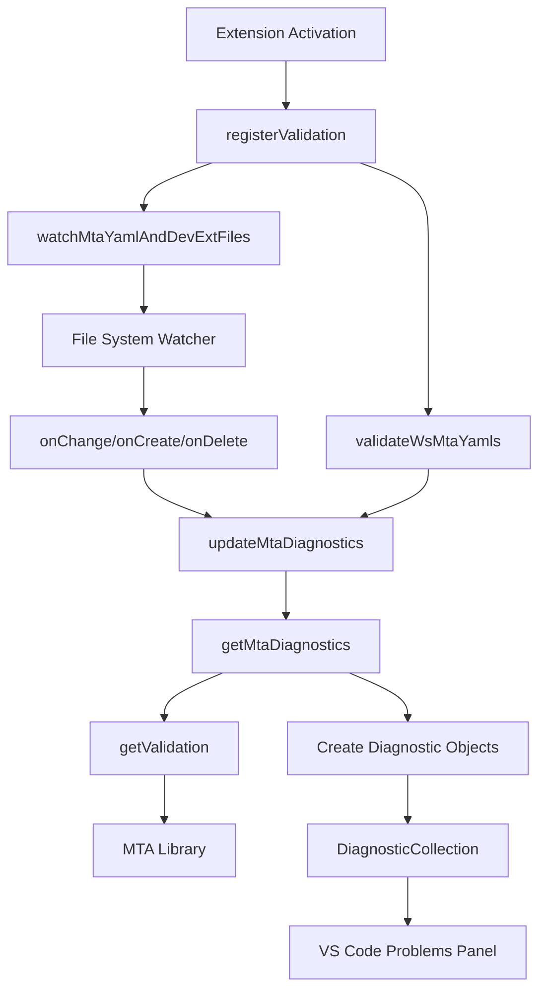
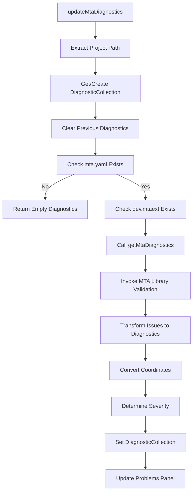

# MTA Validation & Diagnostics System

## Introduction

The MTA Validation & Diagnostics System is a core feature of the vscode-mta-tools extension that provides real-time validation and error reporting for SAP Multi-Target Application (MTA) projects. This system continuously monitors `mta.yaml` descriptor files and optional `dev.mtaext` extension files across the workspace, validating their structure and content against MTA specifications. When issues are detected, the system generates diagnostics that are displayed in VS Code's Problems panel, enabling developers to identify and fix configuration errors quickly. The validation system integrates with the `@sap/mta-lib` library to perform comprehensive MTA-specific validations and leverages VS Code's diagnostic collection API to present findings in a developer-friendly manner.

Sources: [src/validations/validations.ts:1-12](../../../src/validations/validations.ts#L1-L12), [src/validations/mta/mtaValidations.ts:1-20](../../../src/validations/mta/mtaValidations.ts#L1-L20)

## System Architecture

The validation system is organized into three main layers: registration, file watching, and diagnostic generation. The entry point initializes file system watchers and triggers initial workspace validation.



The system follows a reactive architecture where file system events trigger validation workflows that ultimately update the Problems panel with current diagnostic information.

Sources: [src/validations/validations.ts:5-12](../../../src/validations/validations.ts#L5-L12), [src/validations/mta/mtaValidations.ts:22-95](../../../src/validations/mta/mtaValidations.ts#L22-L95)

## Core Components

### Validation Registration

The `registerValidation` function serves as the initialization point for the entire validation system. It accepts a disposables array for proper resource cleanup and performs two critical operations:

1. Establishes file system watchers for MTA-related files
2. Performs initial validation of all MTA YAML files in the workspace

Sources: [src/validations/validations.ts:5-12](../../../src/validations/validations.ts#L5-L12)

### File System Monitoring

The `watchMtaYamlAndDevExtFiles` function creates a file system watcher that monitors changes to `mta.yaml` and `dev.mtaext` files throughout the workspace. It registers event handlers for three types of file system events:

| Event Type                  | Trigger Condition               | Action                               |
| --------------------------- | ------------------------------- | ------------------------------------ |
| onDidChange                 | File content modified           | Re-validate the affected MTA project |
| onDidCreate                 | New file created                | Validate the new MTA project         |
| onDidDelete                 | File deleted                    | Clear diagnostics for deleted files  |
| onDidChangeWorkspaceFolders | Workspace folders added/removed | Re-validate entire workspace         |

The watcher uses a glob pattern `**/{mta.yaml,dev.mtaext}` to monitor both file types simultaneously.

Sources: [src/validations/mta/mtaValidations.ts:22-45](../../../src/validations/mta/mtaValidations.ts#L22-L45)

### Workspace Validation

The `validateWsMtaYamls` function performs validation across all MTA projects in the workspace. It searches for all `mta.yaml` files (excluding `node_modules` directories) and triggers validation for each discovered project.

```typescript
export async function validateWsMtaYamls(
  disposables: Disposable[],
  clearExistingDiagnosticCollections = false
): Promise<void>;
```

When workspace folders are removed, the function can optionally clear all existing diagnostic collections before re-validating to ensure stale diagnostics are removed.

Sources: [src/validations/mta/mtaValidations.ts:47-60](../../../src/validations/mta/mtaValidations.ts#L47-L60)

## Diagnostic Generation Workflow

### Validation Process Flow



The `updateMtaDiagnostics` function orchestrates the validation workflow for a single MTA project. It manages diagnostic collections on a per-project basis, ensuring that diagnostics are properly scoped and can be cleared independently.

Sources: [src/validations/mta/mtaValidations.ts:62-86](../../../src/validations/mta/mtaValidations.ts#L62-L86)

### MTA Library Integration

The `getMtaDiagnostics` function integrates with the `@sap/mta-lib` library to perform actual validation. The process involves:

1. **File Existence Checks**: Verifies that `mta.yaml` exists; returns empty diagnostics if not found
2. **Extension Detection**: Checks for `dev.mtaext` and includes it in validation if present
3. **Validation Execution**: Calls the MTA library's validate method with the project path and optional extension files
4. **Result Transformation**: Converts MTA library issues into VS Code Diagnostic objects

```typescript
const validationRes: Record<string, mta.Issue[]> = await getValidation(
  modulePath,
  devMtaExts
);
```

The validation result is a record mapping file paths to arrays of issues, allowing diagnostics to be associated with the correct source files.

Sources: [src/validations/mta/mtaValidations.ts:88-117](../../../src/validations/mta/mtaValidations.ts#L88-L117)

## Diagnostic Collection Management

### Collection Caching Strategy

The system implements a caching mechanism for diagnostic collections to improve performance and ensure proper cleanup. Collections are stored in a module-level record and reused across validation runs:

```typescript
export let diagnosticCollections: Record<string, DiagnosticCollection> = {};
```

The `getDiagnosticsCollection` function retrieves cached collections or creates new ones as needed. Each collection is identified by a unique name that includes the project path, ensuring diagnostics from different projects don't interfere with each other.

Sources: [src/validations/mta/mtaDiagnostic.ts:11-23](../../../src/validations/mta/mtaDiagnostic.ts#L11-L23)

### Collection Lifecycle

| Operation       | Function                            | Purpose                                           |
| --------------- | ----------------------------------- | ------------------------------------------------- |
| Create/Retrieve | `getDiagnosticsCollection`          | Gets existing or creates new collection           |
| Clear All       | `clearDiagnosticCollections`        | Clears all cached collections (workspace changes) |
| Reset Cache     | `clearCurrentDiagnosticCollections` | Resets cache (primarily for testing)              |

Sources: [src/validations/mta/mtaDiagnostic.ts:13-30](../../../src/validations/mta/mtaDiagnostic.ts#L13-L30)

## Issue Transformation

### Coordinate Conversion

MTA library issues use 1-based line and column numbers, while VS Code uses 0-based coordinates. The `mtaIssueToEditorCoordinate` function handles this conversion:

```typescript
export function convertMtaIssueCoordinateToEditorCoordinate(
  coordinate: number
): number {
  const number = coordinate - 1;
  if (number < 0) {
    return 0;
  }
  return number;
}
```

The function also handles edge cases where line or column numbers are 0 (indicating unavailable position information), converting them to the editor's 0-based coordinate system.

Sources: [src/validations/mta/mtaDiagnostic.ts:32-47](../../../src/validations/mta/mtaDiagnostic.ts#L32-L47)

### Severity Mapping

The `getSeverity` function determines the appropriate VS Code diagnostic severity based on the file type and issue severity:

| File Type  | Issue Severity | Diagnostic Severity |
| ---------- | -------------- | ------------------- |
| dev.mtaext | error          | Warning             |
| dev.mtaext | warning        | Warning             |
| mta.yaml   | error          | Error               |
| mta.yaml   | warning        | Warning             |

This mapping reflects that issues in development extension files (`dev.mtaext`) are always treated as warnings, since these files are optional and used primarily for local development scenarios.

Sources: [src/validations/mta/mtaDiagnostic.ts:49-62](../../../src/validations/mta/mtaDiagnostic.ts#L49-L62)

## Diagnostic Object Structure

Each diagnostic object created by the system follows VS Code's Diagnostic interface:

```typescript
{
  source: "MTA",
  message: issue.message,
  range: mtaIssueToEditorCoordinate(issue),
  severity: getSeverity(filePath, issue.severity),
}
```

The `source` field is set to "MTA" to identify diagnostics from this validation system in the Problems panel. This identifier must be synchronized with the extension's `package.json` configuration.

Sources: [src/validations/mta/mtaValidations.ts:106-111](../../../src/validations/mta/mtaValidations.ts#L106-L111)

## File Type Constants

The system defines constants for the two primary file types it monitors:

| Constant    | Value        | Description                |
| ----------- | ------------ | -------------------------- |
| MTA_YAML    | "mta.yaml"   | Main MTA descriptor file   |
| DEV_MTA_EXT | "dev.mtaext" | Development extension file |

These constants ensure consistency across the validation system and are used in file system watchers, path resolution, and severity determination.

Sources: [src/validations/mta/mtaValidations.ts:15-16](../../../src/validations/mta/mtaValidations.ts#L15-L16)

## Testing Strategy

The validation system includes comprehensive unit tests covering:

### File System Watcher Tests

Tests verify that the system correctly registers watchers for `mta.yaml` and `dev.mtaext` files, including validation of:

- Glob pattern correctness (`**/{mta.yaml,dev.mtaext}`)
- Event handler registration for change, create, and delete events
- Workspace folder change event registration

Sources: [tests/validations/mta/mtaValidations.spec.ts:34-77](../../../tests/validations/mta/mtaValidations.spec.ts#L34-L77)

### Diagnostic Update Tests

Tests cover various scenarios for diagnostic generation:

- No diagnostics when `mta.yaml` doesn't exist
- Correct diagnostic generation for files with errors
- Proper handling of `dev.mtaext` presence/absence
- Clearing of previous diagnostics before new validation runs

Sources: [tests/validations/mta/mtaValidations.spec.ts:79-209](../../../tests/validations/mta/mtaValidations.spec.ts#L79-L209)

### Coordinate Conversion Tests

Tests validate coordinate transformation under various conditions:

- Zero line and column numbers
- Non-zero values requiring decrement
- Negative values (edge case handling)

Sources: [tests/validations/mta/mtaDiagnostic.spec.ts:71-138](../../../tests/validations/mta/mtaDiagnostic.spec.ts#L71-L138)

### Severity Mapping Tests

Tests ensure correct severity assignment based on file type and issue severity combinations, verifying all four possible scenarios for `mta.yaml` and `dev.mtaext` files.

Sources: [tests/validations/mta/mtaDiagnostic.spec.ts:140-163](../../../tests/validations/mta/mtaDiagnostic.spec.ts#L140-L163)

## Summary

The MTA Validation & Diagnostics System provides a robust, real-time validation framework for SAP Multi-Target Application projects within VS Code. By leveraging file system watchers, the `@sap/mta-lib` validation library, and VS Code's diagnostic APIs, the system delivers immediate feedback on configuration errors in both `mta.yaml` descriptor files and optional `dev.mtaext` extension files. The architecture emphasizes performance through diagnostic collection caching, proper resource management through disposables, and accurate error reporting through careful coordinate transformation and severity mapping. This system enables developers to maintain valid MTA configurations and catch errors early in the development process.

Sources: [src/validations/validations.ts](../../../src/validations/validations.ts), [src/validations/mta/mtaValidations.ts](../../../src/validations/mta/mtaValidations.ts), [src/validations/mta/mtaDiagnostic.ts](../../../src/validations/mta/mtaDiagnostic.ts)
